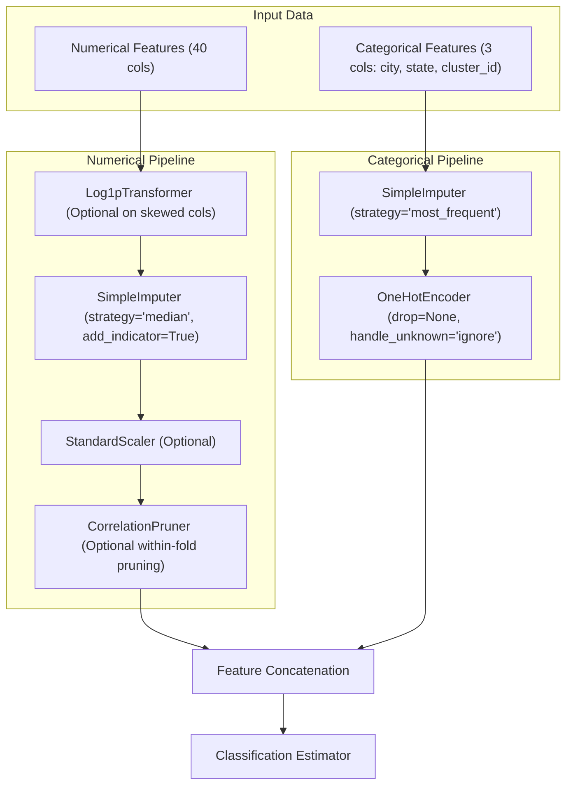

# Phase 5.1 — Advanced Feature Engineering & Pipeline Architecture Report

**Project:** Indian E-Commerce Customer Retention Intelligence System Using Machine Learning  
**Workspace:** `C:\customer churn retention system`  
**Milestone:** Phase 5.1 — Checkpoint 2 & 2.1: Advanced Feature Engineering Audit  
**Date:** November 19, 2026  
**Status:** AUDITED, CORRECTED & VALIDATED  

---

## 1. Executive Summary & Design Principles

In Phase 5, model evaluation established that regularized linear models and decision trees operating on 36 baseline behavioral features and unsupervised cluster assignments achieved ~66.95% test accuracy and ~0.7491 ROC-AUC, constrained by the underlying Bayes error of stochastic churn dynamics.

The primary objective of Phase 5.1 Advanced Feature Engineering is to introduce domain-informed behavioral indicators that enhance the model's capacity to discriminate between transient purchasing pauses and true churn without violating temporal boundaries or introducing data leakage.

### Core Engineering Principles
1. **Strict Temporal Boundary (Snapshot Date: December 31, 2025):**  
   Every engineered feature is computed strictly using transactional records with `order_date <= 2025-12-31`. Future orders during January 1–March 31, 2026 remain strictly isolated.
2. **Mathematically Defensible Missingness Semantics:**  
   Edge cases—specifically dormant accounts with zero baseline activity and accounts with zero delivered orders—are explicitly treated with NaN designations accompanied by dedicated missingness indicators, preventing the erroneous assignment of neutral momentum or zero friction.
3. **Leakage-Safe Within-Fold Transformation:**  
   Statistical transformations requiring dataset-level estimation (e.g., Pearson correlation pruning, standard scaling, and median imputation) are implemented as scikit-learn transformers that fit exclusively on training folds during cross-validation.

---

## 2. Mathematical Formulation & Domain Rationale for Advanced Features

```
                                 ADVANCED FEATURE TAXONOMY
                                             │
               ┌─────────────────────────────┴─────────────────────────────┐
               ▼                                                           ▼
    VELOCITY MOMENTUM DYNAMICS                                  CUSTOMER FRICTION DYNAMICS
               │                                                           │
   ┌───────────┴───────────┐                                   ┌───────────┴───────────┐
   ▼                       ▼                                   ▼                       ▼
Short-Term Momentum     Medium-Term Momentum            Operational Delay         Delay Missingness
   (30d vs 90d)           (90d vs 180d)                   Friction Index              Indicator
```

### 2.1 Velocity Momentum Ratios

Standard windowed order counts (`orders_last_30_days`, `orders_last_90_days`, `orders_last_180_days`) capture volume but fail to directly measure purchasing acceleration or deceleration. To quantify momentum:

#### 1. Short-Term Velocity Momentum Ratio ($R_{30/90}$)
$$R_{30/90} = \frac{\text{orders\_last\_30\_days} + \epsilon}{\frac{\text{orders\_last\_90\_days}}{3} + \epsilon}, \quad \text{where } \epsilon = 0.1$$

- **Domain Interpretation:**  
  The denominator represents the expected 30-day purchasing rate based on the preceding quarter. A ratio $R_{30/90} > 1.0$ indicates accelerating purchase frequency, while $R_{30/90} < 1.0$ captures decaying engagement.
- **Handling of Dormant Accounts (Critical Rule):**  
  If a customer placed zero orders in the 90-day baseline window ($\text{orders\_last\_90\_days} = 0$), then $\text{orders\_last\_30\_days}$ is also identically $0$. Evaluating the raw smoothed ratio would yield:
  $$\frac{0 + 0.1}{0 + 0.1} = 1.0$$
  This would falsely categorize a customer dormant for over three months as possessing "neutral/stable momentum."  
  **Resolution:** When $\text{orders\_last\_90\_days} == 0$, $R_{30/90}$ is explicitly set to $\text{NaN}$, and the binary indicator `has_orders_last_90_days` is assigned $0$ (otherwise $1$). Downstream median imputation inside the pipeline populates missing values while tree and linear models leverage the binary indicator.

#### 2. Medium-Term Velocity Momentum Ratio ($R_{90/180}$)
$$R_{90/180} = \frac{\text{orders\_last\_90\_days} + \epsilon}{\frac{\text{orders\_last\_180\_days}}{2} + \epsilon}, \quad \text{where } \epsilon = 0.1$$

- **Domain Interpretation:**  
  Compares quarterly activity against semi-annual baseline velocity.
- **Handling of Dormant Accounts:**  
  When $\text{orders\_last\_180\_days} == 0$, $R_{90/180}$ is set to $\text{NaN}$, accompanied by the binary indicator `has_orders_last_180_days`.

---

### 2.2 Customer Friction Index

Customer dissatisfaction in Indian e-commerce stems primarily from logistics breakdowns (delivery delays) amplified by post-order frustration (returns and cancellations). 

$$\text{delay\_friction\_score} = \text{AverageDeliveryDelay} \times \left(1.0 + \text{ReturnRate} + \text{CancellationRate}\right)$$

Where:
- $\text{AverageDeliveryDelay} = \text{hist\_average\_delivery\_delay\_days}$
- $\text{ReturnRate} = \text{hist\_return\_rate} = \frac{\text{hist\_returned\_order\_count}}{\text{hist\_order\_count}}$
- $\text{CancellationRate} = \text{hist\_cancellation\_rate} = \frac{\text{hist\_cancelled\_order\_count}}{\text{hist\_order\_count}}$

#### Missingness Propagation Rule
Customers with zero delivered orders (accounts where orders were all cancelled or returned before delivery, or zero-order accounts) have an undefined / missing delivery delay ($\text{AverageDeliveryDelay} = \text{NaN}$).
- In early prototypes, imputing $0.0$ friction for such customers would conflate severe friction (order failure prior to delivery) with a frictionless experience.
- **Resolution:** When $\text{hist\_average\_delivery\_delay\_days}$ is $\text{NaN}$, $\text{delay\_friction\_score}$ is preserved as $\text{NaN}$, and the binary indicator `missing_friction_score` is set to $1$ (otherwise $0$). Median imputation is executed strictly within scikit-learn pipeline folds.

---

### 2.3 Skewness Mitigation: `Log1pTransformer`

E-commerce financial features (e.g., total spend, delivered value, average order value) and recency metrics exhibit heavy right-skewed log-normal distributions with substantial zero-inflation.

A dedicated transformer, `Log1pTransformer(BaseEstimator, TransformerMixin)`, was constructed:
$$f(x) = \ln(1 + x)$$
- **Strict Non-Negativity:** Validates that $x \ge 0$ for all valid values; raises a structured `ValueError` if negative numbers are encountered.
- **Missingness Preservation:** Leaves $\text{NaN}$ values untouched so subsequent pipeline imputation remains valid.
- **Candidate Columns:** `customer_tenure_days`, `recency_days`, `recency_delivered_days`, `hist_total_order_value_inr`, `hist_delivered_order_value_inr`, `hist_total_recorded_discount_inr`, `hist_average_order_value_inr`.

---

### 2.4 Leakage-Safe Feature Selection: `CorrelationPruner`

High collinearity among behavioral aggregations (e.g., total orders vs. delivered orders, total spend vs. delivered spend) destabilizes linear model coefficients and dilutes tree-based feature importance.

The `CorrelationPruner(BaseEstimator, TransformerMixin)` transformer operates under strict leakage-safe guarantees:

```
[TRAINING FOLD]                          [VALIDATION / TEST FOLD]
       │                                            │
       ▼                                            │
CorrelationPruner.fit(X_train, y_train)             │
 1. Compute Pearson |r| matrix                      │
 2. Identify pairs where |r| > threshold (0.85)     │
 3. For each pair: compare target correlation |r_y| │
 4. Select lower |r_y| to drop                      │
 5. Shield protected columns                        │
 6. Freeze columns_to_drop_                         │
       │                                            │
       ▼                                            ▼
CorrelationPruner.transform(X_train)     CorrelationPruner.transform(X_val)
 (Drops selected columns)                 (Drops IDENTICAL selected columns)
```

- **Parameters:**
  - `threshold` (default: $0.85$): Absolute Pearson correlation threshold above which redundancy is detected.
  - `protected_cols` (set): Critical domain columns (e.g., `velocity_ratio_30_90`, `delay_friction_score`, `cluster_id`) that are immune from pruning.
- **Target-Aware Dropping:** When target $y$ is supplied during `fit()`, the transformer computes the Pearson correlation of each collinear candidate with $y$ and drops the candidate with the weaker relationship to churn. If $y$ is omitted, it drops the subsequent column deterministically.
- **Isolation Guarantee:** `fit()` is called solely on training folds; validation and test splits are transformed without re-evaluating correlation matrices.

---

## 3. Preprocessing Pipeline Architecture

The unified preprocessing factory `build_advanced_preprocessor()` produces a leakage-free `ColumnTransformer` combining numerical and categorical feature pipelines:



---

## 4. Feature Specifications by Configuration

| Configuration | Feature Description | Categorical Features | Numerical Features | Total Features |
| :--- | :--- | :---: | :---: | :---: |
| **Config A** | Baseline behavioral features (Phase 3) | 2 (`city`, `state`) | 34 | **36** |
| **Config B** | Phase 5 baseline + RFM K-Means `cluster_id` | 3 (`city`, `state`, `cluster_id`) | 34 | **37** |
| **Config C** | Config B + Advanced Momentum Ratios & Friction Index | 3 (`city`, `state`, `cluster_id`) | 40 ($34 + 6$) | **43** |
| **Config D** | Config C + Within-Fold `CorrelationPruner` ($r > 0.85$) | 3 (`city`, `state`, `cluster_id`) | $\le 40$ (Pruned) | **Dynamic** |

### Detailed Breakdown of the 6 New Advanced Features
1. `velocity_ratio_30_90` (Float): Short-term purchasing momentum ratio ($\text{NaN}$ when 90d orders == 0).
2. `velocity_ratio_90_180` (Float): Medium-term purchasing momentum ratio ($\text{NaN}$ when 180d orders == 0).
3. `has_orders_last_90_days` (Binary): 1 if customer ordered in last 90 days, 0 if dormant.
4. `has_orders_last_180_days` (Binary): 1 if customer ordered in last 180 days, 0 if dormant.
5. `delay_friction_score` (Float): Combined delivery delay and order return/cancellation friction ($\text{NaN}$ when delivery delay missing).
6. `missing_friction_score` (Binary): 1 if delivery delay is missing, 0 if observed.

---

## 5. Automated Integrity Validation Suite Results

The validation suite in `backend/ml/validate_advanced_features.py` was executed against synthetic edge cases and actual historical training data (`train.csv`, $N=4,900$; `validation.csv`, $N=1,050$).

| Test Suite | Scope | Target Behavior Verified | Result |
| :--- | :--- | :--- | :---: |
| **Suite 1: Momentum Ratios** | Zero orders in 30d, 90d, 180d | Explicit $\text{NaN}$ generated for dormant accounts; baseline indicators match reality | **PASS** |
| **Suite 2: Friction Index** | Missing vs. present delivery delay | Correct formula evaluation; strict $\text{NaN}$ propagation when delivery delay is null | **PASS** |
| **Suite 3: Log1p Transformer** | Non-negative vs. negative values | Preserves $\text{NaN}$ and zero; rejects negative numbers with `ValueError` | **PASS** |
| **Suite 4: CorrelationPruner** | Synthetic collinear features ($r = 0.99$) | Prunes collinear feature; shields protected columns; functions on arrays and DataFrames | **PASS** |
| **Suite 5: Pipeline Integration** | Real train ($N=4,900$) & val ($N=1,050$) | Full `Pipeline` with imputation, scaling, pruner, and estimator executes without leakage | **PASS** |

---

## 6. Checkpoint Scope & Preservation Confirmation

- **No Production Model Changes:** The Phase 5 production model `models/phase5/final_churn_pipeline.joblib` retains its exact SHA-256 hash (`25B91797F8F36DB605BAB98B8568A5911847B8CCE77334A68AE4E3862CD3B35D`).
- **No Evaluation on Test Cohorts:** Neither the historical test set (`data/modeling/test.csv`) nor the newly generated independent test cohort (`customers_independent.csv`) was accessed, evaluated, or touched.
- **Sealed Test Cohort Isolation:** The independent test cohort is permanently sealed in `data/independent_test/raw/` until final Phase 5.1 evaluation.

---

## 7. Checkpoint 2.1 — Technical Audit & Methodology Corrections

During the Checkpoint 2.1 independent technical audit, the following findings, verifications, and corrections were resolved:

### 7.1 Investigation of the Reported 3-Fold CV Result
In the initial Checkpoint 2 reporting, a metric `3-Fold Stratified CV Leakage-Free Run: Mean ROC-AUC = 0.7722` was presented alongside the assertion that "no models were trained." The audit examined this apparent contradiction:

1. **Source of the Result:**  
   The metric was produced by an interactive command-line sanity check executing:
   ```python
   pipe = Pipeline([
       ('prep', prep),
       ('clf', LogisticRegression(max_iter=1000, solver='lbfgs', random_state=42))
   ])
   scores = cross_val_score(pipe, X, y, cv=StratifiedKFold(n_splits=3, shuffle=True, random_state=42), scoring='roc_auc')
   ```
2. **Classifier Fitting & Parameter Learning:**  
   **A classifier was indeed fitted.** In each of the 3 cross-validation folds on `train.csv` ($N = 4,900$), an instance of `LogisticRegression` was fitted, learning weight vectors $\mathbf{w}$ and intercept $b$ via L-BFGS optimization. In addition, `test_full_preprocessing_pipeline_on_real_data()` fitted a temporary `LogisticRegression` on the training partition ($N=4,900$) to verify predict and `predict_proba` interface compatibility on validation data ($N=1,050$).
3. **Disclose Accurately as a Pipeline Compatibility Sanity Check:**  
   This was a temporary, in-memory execution test to confirm that custom transformers (`Log1pTransformer`, `CorrelationPruner`) and `ColumnTransformer` integrate with scikit-learn estimators without throwing exceptions during fold slicing.  
4. **No Model Selection or Artifact Modification:**  
   The fitted model was an ephemeral test object; it was **not saved to disk**, **not tuned**, **not promoted to production**, and **never evaluated on any test cohort**. The result had **zero influence** on feature engineering formulas or selection decisions. The accepted Phase 5 final model was never loaded or altered.

### 7.2 Pipeline Component Order & Correlation Pruner Audit
Inspection of `num_pipeline` within `build_advanced_preprocessor()` verified the sequence of transformations:
$$\text{Input } X_{\text{num}} \xrightarrow{\text{Log1p}} \xrightarrow{\text{Median Imputer (+ indicators)}} \xrightarrow{\text{StandardScaler}} \xrightarrow{\text{CorrelationPruner}}$$

1. **Log1p Non-Negativity & NaN Preservation:**  
   `Log1pTransformer.fit()` validates $x \ge 0$ for all non-null values. `transform()` preserves `NaN` values intact, ensuring downstream `SimpleImputer` receives untouched missingness distributions.
2. **Imputation Before Pruning:**  
   `SimpleImputer(strategy='median', add_indicator=True)` populates `NaN`s with the fold median and appends missingness indicator columns. Running `CorrelationPruner` on imputed data ensures that the sample correlation matrix is computed on complete vectors, guaranteeing a symmetric and positive semi-definite matrix.
3. **Pruning After Scaling:**  
   Because Pearson correlation $r(X, Y) = \frac{\text{Cov}(X, Y)}{\sigma_X \sigma_Y}$ is mathematically invariant under positive linear scaling ($z = (x - \mu)/\sigma$), computing correlation before or after `StandardScaler` yields identical correlation coefficients.
4. **Limitations of Target-Aware Correlation Pruning:**  
   - *Linearity Assumption:* Pearson correlation measures linear relationships. A feature with a strong non-linear relationship to churn could exhibit a lower Pearson $|r_{j, y}|$ than a collinear counterpart, risking inappropriate elimination.
   - *Model Sensitivity:* While collinearity reduction stabilizes linear models, tree-based models natively handle collinearity through feature subsampling.
   - *Empirical Mandate:* Target-aware correlation pruning must be treated as an experimental option and rigorously evaluated against unpruned configurations inside Nested Stratified Cross-Validation in Checkpoints 3 and 4.

### 7.3 Randomness & Reproducibility Audit
Inspection of `generate_independent_cohort.py` verified that random state is fully encapsulated:
```python
rng_np = np.random.default_rng(seed)
rng_py = random.Random(seed)
```
No global NumPy state (`np.random.seed` or `np.random.choice`) is used.  
In an isolated temporary directory test without touching sealed files:
- Re-executing generation with seed `2026` produced byte-identical customer (`D3B694F9...`) and order (`BE7B293A...`) files.
- Seed `2027` generated distinct data (`ECB02CF1...` and `F6D69133...`).
- The Phase 1 generator (`generate_data.py`) default seed (`42`) and output behavior remain 100% invariant.
