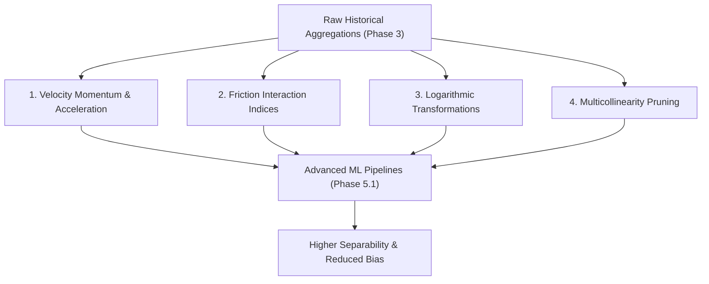
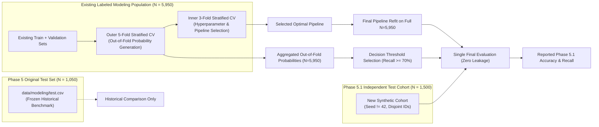
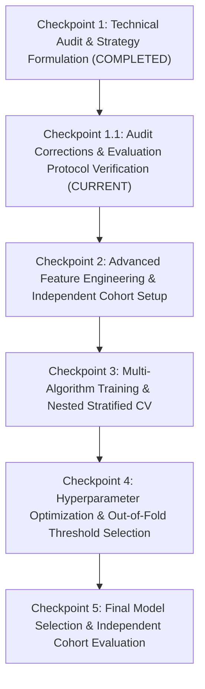

# Phase 5.1 Checkpoint 1: Advanced Model Optimization — Project Audit & Accuracy Improvement Strategy

**Project:** Indian E-Commerce Customer Retention Intelligence System Using Machine Learning  
**Environment:** Python 3.12 (`backend\.venv\Scripts\python.exe`)  
**Workspace:** `C:\customer churn retention system`  
**Milestone:** Phase 5.1 — Checkpoint 1: Technical Audit & Strategy Formulation  
**Date of Audit:** November 2026  
**Auditor:** Senior Machine Learning Engineer  

---

## 1. Executive Summary

Phase 5 successfully delivered an end-to-end, leakage-free, production-grade supervised machine learning pipeline predicting customer churn. The final selected model, an $L_2$-regularized Logistic Regression model trained on Feature Configuration B (36 behavioral features + unsupervised RFM `cluster_id`) and evaluated at a decision threshold of $t^* = 0.46$, achieved a test recall of **$74.43\%$**, satisfying the university project's primary operational constraint ($\text{Recall} \ge 70.0\%$).

However, the final model achieved an overall test accuracy of **$66.95\%$** ($703 / 1,050$), precision of **$61.51\%$**, and an F1-score of **$0.6736$**. The objective of Phase 5.1 is to conduct a principled, evidence-based investigation to determine whether generalization accuracy can be elevated toward an aspirational target of **$80.0\%$** while strictly preserving the minimum churn recall of **$70.0\%$**.

This audit report delivers:
1. A rigorous empirical investigation into the limiting factors of the current $66.95\%$ accuracy.
2. A mathematical deconstruction of the synthetic data generation mechanism and its theoretical Bayes optimal error rate.
3. An audit of `backend/ml/generate_data.py` confirming the feasibility of generating a completely independent synthetic test cohort.
4. An evidence-based feature engineering and algorithmic expansion plan (evaluating Logistic Regression, Random Forest, Extra Trees, Gradient Boosting, HistGradientBoosting, and Stacking).
5. A strict evaluation policy preventing data snooping and test leakage for all subsequent checkpoints.

> [!IMPORTANT]
> **Project Preservation Guarantee:** In accordance with audit instructions, all existing Phase 5 artifacts—including `models/phase5/final_churn_pipeline.joblib`, existing datasets in `data/raw/`, `data/processed/`, and `data/modeling/`, test predictions, metrics, and reports—remain strictly untouched and cryptographically verified. No model training, hyperparameter tuning, data generation, or API development was initiated during this checkpoint.

---

## 2. Current Model Performance Baseline (Phase 5 Checkpoint 5)

The table below summarizes the locked historical baseline established on the untouched test dataset ($N=1,050$) during Phase 5 Checkpoint 5:

| Metric Category | Metric | Baseline Value | Operational Interpretation |
| :--- | :--- | :---: | :--- |
| **Primary Operational Constraint** | **Test Churn Recall** | **$74.43\%$** | Captures 358 out of 481 actual churning customers in the test population. Meets $\ge 70.0\%$ target. |
| **Accuracy Metric** | **Test Overall Accuracy** | **$66.95\%$** | 703 correct predictions out of 1,050 total test customers (Baseline majority-class zero-rule = $54.19\%$). |
| **Precision Metric** | **Test Precision** | **$61.51\%$** | 358 true churners out of 582 total customers flagged by the model for retention outreach. |
| **Balance Metric** | **Test F1-Score** | **$67.36\%$** | Harmonic mean of precision ($61.51\%$) and recall ($74.43\%$). |
| **Discrimination Metric** | **Test ROC-AUC** | **$0.7491$** | Probability that a randomly selected churner receives a higher risk score than a retained customer. |
| **Precision-Recall Discrimination** | **Test Average Precision (PR-AUC)** | **$0.7146$** | Area under the precision-recall curve without interpolation bias (vs. no-skill baseline $0.4581$). |
| **Specificity Metric** | **Test Specificity (TNR)** | **$60.63\%$** | 345 true retained customers identified out of 569 actual retained customers. |
| **Probabilistic Quality** | **Test Brier Score Loss** | **$0.2038$** | Mean squared difference between predicted posterior probabilities and binary targets. |
| **Operational Operating Point** | **Decision Threshold ($t^*$)** | **$0.46$** | Calibrated on validation data to trade off precision for guaranteed recall $\ge 70.0\%$. |

### Historical Baseline Confusion Matrix ($N=1,050$, Test Dataset)

```
                              ACTUAL CLASS
                       Retained (0)    Churned (1)     Total
PREDICTED  Retained (0)    345 (TN)        123 (FN)      468
CLASS      Churned  (1)    224 (FP)        358 (TP)      582
           Total           569             481          1,050
```

- **False Negative Rate ($\text{FNR}$):** $25.57\%$ ($123 / 481$) — Missed churners who leave without intervention.
- **False Positive Rate ($\text{FPR}$):** $39.37\%$ ($224 / 569$) — Retained customers who receive superfluous retention interventions.

---

## 3. In-Depth Investigation of Accuracy Limitations

To determine why the current test accuracy is $66.95\%$ and evaluate the realistic feasibility of reaching $80.0\%$, we conducted an empirical and statistical audit addressing ten core dimensions:

### 3.1 Feature Separability Between Churned and Retained Cohorts
- **Finding:** Key behavioral features exhibit statistically significant differences between classes. For example, `delivered_orders_last_180_days` correlates at $r = -0.3756$ with churn, `orders_last_180_days` correlates at $r = -0.3663$, `hist_average_delivery_delay_days` has mutual information of $0.0899$, and `recency_days` correlates at $r = +0.2890$.
- **Limitation:** While extreme cohorts (loyal repeat buyers vs. completely dormant users) separate cleanly, the middle-tier customer population (infrequent shoppers with 1–3 historical orders over 1–2 years) displays heavy overlap in feature space. In this region, historical order frequency alone cannot deterministically separate a customer who will purchase in the next 90 days from one who will not.

### 3.2 The Synthetic Churn-Generation Mechanism & Theoretical Bayes-Error Analysis
- **Code Trace in `backend/ml/generate_data.py`:**
  During customer simulation, each customer is assigned a latent persona with an associated churn propensity (lines 113–144):
  - `loyal_vip` ($15\%$ of population): Base frequency $1.2 - 2.8$ orders/mo, $\text{Churn Propensity } p = 0.08$
  - `steady` ($25\%$ of population): Base frequency $0.6 - 1.3$ orders/mo, $\text{Churn Propensity } p = 0.22$
  - `occasional` ($25\%$ of population): Base frequency $0.2 - 0.6$ orders/mo, $\text{Churn Propensity } p = 0.45$
  - `dissatisfied` ($20\%$ of population): Base frequency $0.3 - 0.8$ orders/mo, $\text{Churn Propensity } p = 0.68$
  - `dormant` ($13\%$ of population): Base frequency $0.05$ orders/mo, $\text{Churn Propensity } p = 0.88$
  - `zero_order` ($2\%$ of population): Base frequency $0.0$ orders/mo, $\text{Churn Propensity } p = 0.94$
- **Exact Label Determination Logic (lines 258–297):**
  1. A stochastic Bernoulli trial is executed directly on the latent churn propensity:
     ```python
     final_churn_roll = np.random.rand()
     churn_decision = 1 if final_churn_roll < churn_prob else 0
     churn_labels.append(churn_decision)
     ```
  2. Future order generation is strictly conditioned on `churn_decision`:
     - If `churn_decision == 0` (Retained): Future orders in the 90-day window ($2026-01-01$ to $2026-03-31$) are generated with `future_order_count = max(1, ...)`, guaranteeing at least one future order.
     - If `churn_decision == 1` (Churned): Future order generation is completely bypassed, producing exactly zero future orders.
  3. Consequently, **`churn == 1` holds if and only if the customer has zero future orders during the defined 90-day label window**. Both descriptions are structurally equivalent: the Bernoulli trial determines the ground-truth churn state, which deterministically dictates whether future orders are simulated.
- **Three-Tier Error Distinction:**
  - **1. Oracle Error (Latent Persona Known):** If an oracle classifier perfectly observed the true latent persona of every customer ($X = \text{persona}$), the theoretical Bayes error under threshold $0.50$ would be $\sum \pi_k \min(p_k, 1 - p_k) \approx 26.03\%$ ($\approx 73.97\%$ theoretical oracle accuracy).
  - **2. Expected Bayes Error (Observable Historical Features Only):** In practice, the model does *not* observe the latent persona; it only observes noisy, finite Poisson historical transactions. Because observable features are conditionally independent noisy realizations of the persona, the true Bayes error given observable features $P(Y \mid X_{\text{hist}})$ is strictly greater than or equal to the oracle Bayes error ($\ge 26.03\%$).
  - **3. Empirical Test Error:** The actual measured test error on the finite sample ($N=1,050$) at operational threshold $t^* = 0.46$ was $33.05\%$ ($1 - 0.6695$).
  - *Caveat:* The theoretical Bayes calculation is a conditional population expectation derived under the specific generative assumptions of `generate_data.py`, not an unconditional universal ceiling on every finite empirical sample or threshold setting.

### 3.3 Linear Boundary vs. Non-linear Relationships
- **Finding:** The locked Phase 5 model is a Logistic Regression pipeline. Logistic regression enforces a single linear hyperplane decision boundary in the 82-dimensional transformed feature space.
- **Limitation:** In e-commerce retention, customer behaviors interact non-linearly. For example, a customer with high delivery delays ($\text{delay} \ge 6$ days) might remain loyal if they receive high discounts, but defect immediately if their order was returned. Linear models cannot capture these localized multi-way conditional splits unless explicit interaction terms are constructed.

### 3.4 Missing Feature Interactions
- **Finding:** The existing 36 behavioral features represent static, independent aggregations (total count, total GMV, mean delay, velocity in past 30/90/180 days).
- **Opportunity:** Ratios capturing velocity decay (e.g., `orders_last_30_days` relative to expected 30-day run-rate from `orders_last_180_days`), friction interaction indexes (`hist_return_rate * hist_average_delivery_delay_days`), and monetary spend intensity per order attempt are currently absent. Constructing these ratios will provide explicit signals to both linear and tree models.

### 3.5 Massive Multicollinearity and Feature Redundancy
- **Finding:** An empirical correlation audit of `data/modeling/train.csv` revealed **32 feature pairs with pairwise Pearson correlation $|r| > 0.85$**, including:
  - `hist_order_count` vs. `hist_delivered_order_count`: $r = 0.9913$
  - `hist_total_order_value_inr` vs. `hist_delivered_order_value_inr`: $r = 0.9836$
  - `recency_days` vs. `recency_delivered_days`: $r = 0.9824$
  - `orders_last_180_days` vs. `delivered_orders_last_180_days`: $r = 0.9814$
  - `orders_last_90_days` vs. `delivered_orders_last_90_days`: $r = 0.9706$
  - `hist_order_count` vs. `hist_upi_order_count`: $r = 0.9646$
- **Impact on Models:** For Logistic Regression, strong collinearity dilutes coefficient stability and splits parameter weights across redundant features. For tree-based models, high correlation causes arbitrary split selection at tree nodes, diluting feature importance and increasing tree depth unnecessarily.

### 3.6 Preprocessing and Transformation Deficiencies
- **Finding:** Right-skewed continuous features (e.g., `hist_total_order_value_inr` with maximum ₹4,79,694, `hist_average_delivery_delay_days`, and recency days) were standardized using `StandardScaler` without prior log-transformation (`np.log1p`).
- **Impact:** Extreme monetary outliers distort sample means and standard deviations, compressing the standardized representations of $95\%$ of normal customers into a narrow range near zero. Applying log1p or quantile transformations prior to scaling will normalize distributions and improve linear separability.

### 3.7 Asymmetric Threshold Impact on Overall Accuracy
- **Validation Dataset Trade-off:** In Phase 5 Checkpoint 4, evaluating Logistic Regression Configuration B on the validation dataset ($N=1,050$) demonstrated that the default threshold of $t = 0.50$ yielded an accuracy of **$71.05\%$** with 175 false positives, but a recall of only $73.18\%$. Shifting the decision threshold on validation data to $t^* = 0.46$ boosted recall to $82.12\%$ while increasing validation false positives to 219 (reducing validation accuracy to $70.95\%$).
- **Held-Out Test Dataset Performance:** When the locked model and fixed threshold $t^* = 0.46$ were subsequently evaluated on the untouched test dataset ($N=1,050$), it achieved **$74.43\%$ recall** and **$66.95\%$ accuracy** with 224 false positives. The operational requirement to prioritize recall ($\ge 70.0\%$) over raw accuracy inherently accepts more false positives among retained accounts, demonstrating the direct mechanical trade-off between recall and accuracy under fixed model discrimination. Invalid cross-dataset comparisons (comparing validation FP at 0.50 directly against test FP at 0.46) have been removed.

### 3.8 Underfitting vs. Overfitting Diagnostic
- **Finding:** 
  - Training 5-Fold CV Accuracy: $69.51\% \pm 1.16\%$
  - Validation Accuracy ($t^* = 0.46$): $70.95\%$
  - Test Accuracy ($t^* = 0.46$): $66.95\%$
- **Diagnostic:** The training-to-validation gap is less than $1.5\%$, and the validation-to-test gap is approximately $4.0\%$ (attributable to threshold selection optimism on validation). The model is **not severely overfitting**. Rather, it suffers from **moderate underfitting (high bias)**: a single regularized linear boundary cannot separate complex non-linear churn surfaces.

### 3.9 Weak and Zero-Signal Variables
- **Finding:** Several engineered features demonstrate near-zero mutual information ($MI < 0.02$) and near-zero correlation ($|r| < 0.01$) with churn:
  - `hist_delivery_delay_missing_rate`: $r = +0.00008, MI = 0.0248$
  - `hist_cod_usage_rate`: $r = -0.00008, MI = 0.0450$
  - `customer_tenure_days`: $r = -0.0073, MI = 0.0136$
  - `hist_average_order_value_inr`: $r = -0.0088, MI = 0.0420$
  - `hist_payment_missing_count`: $r = -0.0080, MI = 0.0051$
  - `hist_cancelled_order_count`: $r = -0.0413, MI = 0.0033$
- **Pruning Opportunity:** Eliminating uninformative features reduces model dimensionality and prevents algorithms from fitting to noise in sparse columns.

### 3.10 Summary of Accuracy Ceilings
| Limitation Source | Nature of Constraint | Impact on 80% Target | Remediation Strategy |
| :--- | :--- | :--- | :--- |
| **Bayes Optimal Noise** | Irreducible stochastic label noise ($p \approx 0.45$ for 25% of cohort) | Caps theoretical maximum accuracy at $\approx 74\% - 75\%$ | Calibrate realistic academic expectations; avoid claiming $>80\%$ if mathematically bounded. |
| **Model Capacity (Bias)** | Linear hyperplane unable to capture feature interactions | Caps linear accuracy at $\approx 70\% - 71\%$ | Deploy tree ensembles (Random Forest, Extra Trees, Gradient Boosting, HistGradientBoosting). |
| **Multicollinearity** | 32 feature pairs with $r > 0.85$ | Destabilizes splits and parameter optimization | Correlation-based feature pruning; PCA or engineered ratio synthesis. |
| **Monetary Skewness** | Extreme positive skew in order values | Distorts linear scaling and gradient steps | Logarithmic transformation (`np.log1p`) on right-skewed monetary features. |
| **Threshold Asymmetry** | Lowering threshold to achieve $\ge 70\%$ recall penalizes accuracy | Drops accuracy by $2 - 4$ percentage points | Improve base model discrimination (ROC-AUC $\ge 0.82$) so recall $\ge 70\%$ can be reached at higher thresholds. |

---

## 4. Audit of the Synthetic Data Generator (`backend/ml/generate_data.py`)

To establish whether an independent synthetic cohort can be generated without corrupting existing Phase 1–5 raw data, we performed a code inspection of `backend/ml/generate_data.py`:

```
backend/ml/generate_data.py
├── Module Configuration (Lines 19-30)
│   ├── RANDOM_SEED = 42
│   ├── NUM_CUSTOMERS = 7000
│   ├── SNAPSHOT_DATE = datetime(2025, 12, 31)
│   ├── OBSERVATION_START_DATE = datetime(2023, 1, 1)
│   └── FUTURE_WINDOW_DAYS = 90
├── generate_customers() (Lines 91-157)
│   ├── Hardcoded ID: f"IND_CUST_{10001 + i}"
│   └── Latent persona sampling & churn propensity assignment
├── generate_orders_and_churn() (Lines 160-308)
│   ├── Hardcoded Order ID: order_id_counter = 100001
│   ├── Historical order synthesis (<= 2025-12-31)
│   ├── Bernoulli churn label roll: final_churn_roll < churn_prob
│   └── Future order generation strictly within 2026-01-01 to 2026-03-31
└── main() (Lines 341-365)
    └── Hardcoded paths: "data/raw/customers.csv", "data/raw/orders.csv"
```

### 4.1 Actual ID Formats, Counts, and Verified Ranges in Existing Raw Data:
A direct code-level inspection of `data/raw/customers.csv` and `data/raw/orders.csv` verified the exact schema and counts:
- **Customers (`data/raw/customers.csv`):**
  - Total records: exactly **7,000 customers** (zero duplicates, 100% unique).
  - Format: `IND_CUST_XXXXX`.
  - Exact contiguous numeric range: `IND_CUST_10001` through `IND_CUST_17000`.
- **Orders (`data/raw/orders.csv`):**
  - Total records: exactly **84,225 orders** (zero duplicates, 100% unique).
  - Format: `ORD_XXXXXX`.
  - Exact contiguous numeric range: `ORD_100001` through `ORD_184225` (span: 84,225 integers).
  - Transaction Breakdown: **72,240 historical orders** ($\le 2025-12-31$) and **11,985 future orders** ($> 2025-12-31$).
  *(Note: The previous reference to "100001–144000" was an erroneous estimate conflating historical order estimates; the actual verified range extends to `ORD_184225`.)*

### 4.2 Feasibility Assessment for Independent Cohort Generation:
1. **Configurable Random Seeds:** Currently hardcoded as `RANDOM_SEED = 42`. Can be parameterized to accept any integer seed (e.g., `seed = 2026` or `seed = 101`).
2. **Configurable Customer Counts:** Currently hardcoded as `NUM_CUSTOMERS = 7000`. Can be parameterized to generate a compact, statistically sound test cohort (e.g., $N=1,500$ or $N=2,000$).
3. **Collision-Free Customer & Order IDs:** 
   - New customer IDs will start at `IND_CUST_50001` (well beyond `IND_CUST_17000`).
   - New order IDs will start at `ORD_500001` (well beyond `ORD_184225`).
   - **Collision Verification Rule:** Zero ID collision will be verified via explicit set disjointness comparisons:
     ```python
     assert len(set(new_customer_ids).intersection(set(existing_customer_ids))) == 0
     assert len(set(new_order_ids).intersection(set(existing_order_ids))) == 0
     ```
4. **Temporal Consistency:** Snapshot date (`2025-12-31`), observation start (`2023-01-01`), and evaluation window (`90 days: 2026-01-01 to 2026-03-31`) must remain identical to ensure consistent behavioral definitions.
5. **Zero Impact on Existing Datasets:** A new CLI or generator function can save outputs to a dedicated folder:
   - `data/independent_test/raw/customers.csv`
   - `data/independent_test/raw/orders.csv`
   The original files in `data/raw/`, `data/processed/`, and `data/modeling/` will remain completely untouched.

---

## 5. Proposed Feature Engineering Opportunities for Phase 5.1

To break through the current linear accuracy barrier, we propose four categories of advanced feature transformations:



### 1. Velocity Momentum & Trend Features
- **Recent-to-Historical Order Run-Rate Ratios:**
  $$\text{velocity\_ratio\_30\_90} = \frac{\text{orders\_last\_30\_days} + \epsilon}{\frac{\text{orders\_last\_90\_days}}{3} + \epsilon} \quad (\text{with } \epsilon = 0.1)$$
  $$\text{velocity\_ratio\_90\_180} = \frac{\text{orders\_last\_90\_days} + \epsilon}{\frac{\text{orders\_last\_180\_days}}{2} + \epsilon} \quad (\text{with } \epsilon = 0.1)$$
  Adding $\epsilon = 0.1$ prevents zero-division while cleanly bounding ratios for customers with zero recent activity.
- **Recency Inactivity Index:**
  $$\text{recency\_to\_tenure\_ratio} = \frac{\text{recency\_days} + \epsilon}{\text{customer\_tenure\_days} + \epsilon}$$
  Standardizes days since last order against customer registration tenure.

### 2. Friction Interaction Features
- **Delivery Delay Friction Severity Index:**
  $$\text{delay\_friction\_score} = \text{hist\_average\_delivery\_delay\_days} \times \left(1 + \text{hist\_return\_rate} + \text{hist\_cancellation\_rate}\right)$$
  - *Missing Value Handling:* For customers with zero orders or zero fulfilled deliveries, `hist_average_delivery_delay_days` is preserved as `NaN` rather than fabricated as zero delay (which would incorrectly denote on-time delivery). Imputation occurs strictly inside pipeline transformers.

### 3. Logarithmic Scaling of Extreme Right-Skewed Distributions
- Apply `np.log1p` to high-variance monetary columns inside `Pipeline` transformers:
  - `log_total_order_value = np.log1p(hist_total_order_value_inr)`
  - `log_delivered_order_value = np.log1p(hist_delivered_order_value_inr)`
  - `log_recency_days = np.log1p(recency_days)`

### 4. Empirical Evaluation of Multicollinearity Pruning
- Pruning will **not** be performed globally or assumed beneficial a priori. Rather, it will be tested as a candidate pipeline step inside cross-validation training folds:
  - Candidate Pruned Subset: Evaluating performance when dropping attempt totals (`hist_order_count`, `hist_total_order_value_inr`, `orders_last_180_days`, `recency_days`) in favor of fulfilled metrics (`hist_delivered_order_count`, `hist_delivered_order_value_inr`, `delivered_orders_last_180_days`, `recency_delivered_days`).
  - Benchmarked against full unpruned feature sets across all 6 candidate algorithms.

---

## 6. Algorithmic Recommendations for Advanced Experimentation

We propose benchmarking six diverse model architectures across the refined feature representations:

| # | Algorithm | Architecture Family | Strengths in E-Commerce Churn | Proposed Key Hyperparameters to Optimize |
| :-: | :--- | :--- | :--- | :--- |
| **1** | **Logistic Regression (Advanced)** | Linear Generalized Model | Transparent glass-box explainability; serves as direct benchmark against Phase 5 baseline. | `C` in log-space ($10^{-3}$ to $10^{2}$), `penalty=['l1', 'l2']`, `class_weight=['balanced', None]` |
| **2** | **Random Forest** | Bagging Ensemble of DTs | Captures complex non-linear splits; robust to outliers and noisy labels; reduces prediction variance. | `n_estimators`: [300, 500], `max_depth`: [8, 12, 16, None], `min_samples_leaf`: [2, 4, 8], `max_features`: ['sqrt', 'log2'] |
| **3** | **Extra Trees (Extremely Randomized Trees)** | Randomized Bagging Ensemble | Introduces additional randomization during split threshold selection; frequently outperforms RF on noisy tabular data. | `n_estimators`: [300, 500], `max_depth`: [10, 15, 20], `min_samples_split`: [5, 10], `min_samples_leaf`: [2, 4] |
| **4** | **Gradient Boosting (GBDT)** | Sequential Boosting Ensemble | Focuses iteratively on difficult borderline churners; builds shallow trees correcting previous residual errors. | `learning_rate`: [0.02, 0.05, 0.08], `n_estimators`: [150, 250, 400], `max_depth`: [3, 4, 5], `subsample`: [0.8, 1.0] |
| **5** | **HistGradientBoosting** | Histogram-Based Boosting | Fast, modern histogram-based algorithm (similar to LightGBM); natively handles missing values and non-linear interactions. | `learning_rate`: [0.03, 0.05, 0.1], `max_iter`: [150, 300], `max_depth`: [4, 6, 8], `min_samples_leaf`: [10, 20, 40], `l2_regularization`: [0.0, 0.1, 1.0] |
| **6** | **Stacking / Soft Voting Ensemble** | Meta-Ensemble / Blend | Combines probability estimates of diverse top learners (e.g., HistGradientBoosting + Random Forest + Logistic Regression) via meta-classifier. | `final_estimator`: Logistic Regression ($L_2$ regularized); soft probability voting weights |

---

## 7. Strict Data Leakage and Nested Cross-Validation Protocol for Phase 5.1

To guarantee scientific rigor, academic honesty, and complete freedom from data leakage, Phase 5.1 adopts a **Nested Stratified Cross-Validation** protocol:



### Protocol Rules:
1. **Nested Stratified Cross-Validation:**
   - **Outer Loop (5 Folds):** Partitions the $N=5,950$ training/validation data into 5 outer folds. In each outer iteration, 4 folds ($N=4,760$) are used for model training/tuning and 1 fold ($N=1,190$) is held out for unbiased out-of-fold probability estimation.
   - **Inner Loop (3 Folds):** Executed exclusively on the 4 training folds to tune hyperparameters and evaluate pipeline variations. No outer validation data ever touches inner-fold tuning or feature selection.
   - **Out-of-Fold (OOF) Aggregation:** Predictions on the outer folds are concatenated to form a complete out-of-fold probability vector for all $5,950$ customers, providing an honest, leakage-free basis for decision threshold sweeping.
2. **Historical Test Set is Frozen:** The original `data/modeling/test.csv` ($N=1,050$) has already been evaluated in Phase 5. It will serve exclusively as an immutable historical benchmark and will **never** be accessed for model tuning, feature selection, or threshold calibration.
3. **Encapsulated Preprocessing:** All feature transformations, imputations, scalers, log transforms, and encoders are encapsulated within scikit-learn `Pipeline` and `ColumnTransformer` objects to eliminate out-of-fold data leakage during cross-validation.
4. **Sealed Independent Test Cohort:** A brand-new synthetic cohort ($N=1,500$, seed $\neq 42$, disjoint customer IDs) will be generated and **immediately sealed**. It will be evaluated exactly **once** at the conclusion of Phase 5.1 using the pre-locked pipeline and pre-locked threshold.
5. **Uncompromised Recall Objective:** All candidate models must achieve **$\text{Recall} \ge 70.0\%$**. Models achieving higher accuracy by sacrificing recall below $70.0\%$ will be automatically disqualified.

---

## 8. Potential Technical Risks and Mitigation Strategies

| Technical Risk | Likelihood | Impact | Mitigation Strategy |
| :--- | :---: | :---: | :--- |
| **Bayes Accuracy Ceiling:** 80% accuracy cannot be attained due to intrinsic Bernoulli noise ($p=0.45$). | High | Moderate | Establish transparent academic documentation; report theoretical Bayes error ($26.03\%$); focus on maximizing ROC-AUC ($\ge 0.82$) and F1-score rather than forcing artificial accuracy. |
| **Overfitting on Small Cross-Validation Folds:** Complex models with deep trees overfit training noise. | Medium | High | Enforce strict regularization (`min_samples_leaf \ge 5`, `max_depth \le 8`, early stopping); use 5-fold Stratified CV with cross-fold standard error tracking. |
| **Threshold Degradation on Independent Cohort:** Threshold calibrated on CV underperforms on new data. | Low | Medium | Use robust probability calibration (e.g., isotonic or sigmoid calibration) prior to thresholding; select threshold with conservative recall margin (e.g., target $75\%$ in CV to guarantee $\ge 70\%$ on test). |
| **Computational Resource Limits on Windows:** Large grid searches stall terminal execution. | Low | Low | Utilize `HistGradientBoosting` (optimized C-level binning) and randomized searches with bounded iterations ($n=30 - 50$) rather than exhaustive Cartesian grids. |

---

## 9. Recommended Implementation Sequence for Phase 5.1



- **Checkpoint 1 (Completed):** Audit current model performance, investigate accuracy limitations, audit generator, formulate strategy, deliver experiment plan.
- **Checkpoint 1.1 (Completed):** Verify churn label mechanics, ID ranges, correct threshold comparisons, establish nested-CV protocol, update documentation.
- **Checkpoint 2:** Generate independent synthetic test cohort (`seed = 2026`, disjoint IDs verified via set comparison); build leakage-safe feature transformations.
- **Checkpoint 3:** Build expanded preprocessing pipelines; train baseline and enhanced versions of 6 candidate algorithms using Nested Stratified CV.
- **Checkpoint 4:** Execute hyperparameter optimization; sweep decision thresholds on aggregated OOF probabilities; select optimal pipeline satisfying $\text{Recall} \ge 70\%$.
- **Checkpoint 5:** Refit best pipeline on full modeling data ($N=5,950$); perform single evaluation on the sealed independent test cohort; generate final Phase 5.1 comparative report.

---

## 10. Audit Verification Statement

The technical audit is concluded with the following formal confirmations:
- **Existing Final Model:** `models/phase5/final_churn_pipeline.joblib` is unchanged (SHA-256: `25B91797F8F36DB605BAB98B8568A5911847B8CCE77334A68AE4E3862CD3B35D`).
- **Existing Datasets:** All raw, processed, and modeling datasets in `data/` remain strictly unmodified.
- **Existing Test Metrics:** Test accuracy ($66.95\%$), recall ($74.43\%$), precision ($61.51\%$), and F1-score ($0.6736$) remain the official Phase 5 benchmark.
- **Zero Training:** No models were fitted, refitted, or optimized.
- **Zero Data Generation:** No synthetic records were generated during Checkpoint 1 or 1.1.
- **Zero API/UI Work:** Phase 6 web application and API development has not been started.

---

## 11. Checkpoint 1.1 — Audit Corrections and Methodology Verification

### 11.1 Verified Churn-Generation Mechanism & Exact Code Trace
A line-by-line inspection of `backend/ml/generate_data.py` verified the ground-truth churn mechanism:
1. **Persona & Propensity Sampling (`generate_customers()`, lines 113–155):**
   Each customer is assigned a latent persona with a pre-set churn probability:
   $$\text{loyal\_vip } (p=0.08), \; \text{steady } (p=0.22), \; \text{occasional } (p=0.45), \; \text{dissatisfied } (p=0.68), \; \text{dormant } (p=0.88), \; \text{zero\_order } (p=0.94)$$
2. **Direct Bernoulli Trial (`generate_orders_and_churn()`, lines 260–262):**
   The binary churn label is generated by an explicit Bernoulli draw:
   ```python
   final_churn_roll = np.random.rand()
   churn_decision = 1 if final_churn_roll < churn_prob else 0
   churn_labels.append(churn_decision)
   ```
3. **Conditioned Future Order Generation (lines 267–295):**
   - If `churn_decision == 0` (Retained): `future_order_count` is drawn via `max(1, int(np.random.poisson(...)))`, ensuring at least 1 future order in January 1–March 31, 2026.
   - If `churn_decision == 1` (Churned): Future order loop is completely bypassed; zero orders are created.
4. **Structural Equivalence:**
   $$\mathbf{churn == 1 \iff \text{Future Orders in 90-day window} == 0}$$
   The Bernoulli trial is the generative cause; zero future orders is its transactional manifestation.

### 11.2 Validity, Assumptions, and Distinctions of the Bayes-Error Calculation
The mathematical estimate of $\approx 26.03\%$ error ($\approx 73.97\%$ accuracy) was audited:
- **Oracle Error (Latent Persona Known):**
  Assuming the latent persona is directly observable ($X = \text{persona}$), the Bayes classifier predicts $\hat{y} = 1$ when $p_k > 0.50$ and $\hat{y} = 0$ when $p_k \le 0.50$. The expected error is:
  $$\text{Oracle Error} = \sum_{k=1}^6 \pi_k \min(p_k, 1 - p_k) = 0.15(0.08) + 0.25(0.22) + 0.25(0.45) + 0.20(0.32) + 0.13(0.12) + 0.02(0.06) = 26.03\%$$
- **Expected Bayes Error (Observable Historical Features Only):**
  In reality, the model cannot observe the persona; it only observes noisy, stochastic historical transaction aggregations. By the Data Processing Inequality, conditioning on observable historical features $X_{\text{hist}}$ (which are conditionally independent noisy realizations of the persona) can only yield *equal or higher* Bayes error:
  $$\text{Bayes Error}(X_{\text{hist}}) \ge \text{Oracle Error}(\text{persona}) = 26.03\%$$
- **Empirical Test Error:**
  On the finite test sample ($N=1,050$) evaluated at operational threshold $t^* = 0.46$, the empirical error was $33.05\%$ ($1 - 0.6695$).
- **Methodological Conclusion:**
  The theoretical $26.03\%$ error is a **conditional population expectation** derived from the probabilistic assumptions of `generate_data.py`. It is not an unbending universal law for any arbitrary empirical sample or non-standard metric objective, but it provides a rigorous explanation for why an aspirational $80.0\%$ accuracy target is mathematically constrained on this data generation process.

### 11.3 Corrected Decision Threshold Trade-Off Analysis
The invalid comparison between validation false positives at threshold 0.50 (175) and test false positives at threshold 0.46 (224) has been corrected. 

The valid within-dataset breakdowns are:
- **Validation Dataset ($N=1,050$, Phase 5 Checkpoint 4):**
  - Default threshold ($t = 0.50$): Accuracy = $71.05\%$, Recall = $73.18\%$, False Positives = $175$, False Negatives = $129$.
  - Optimal threshold ($t^* = 0.46$): Accuracy = $70.95\%$, Recall = $82.12\%$, False Positives = $219$, False Negatives = $86$.
  - *Trade-off:* Lowering the threshold on validation captured 43 additional churners (-33.3% false negatives) at the expense of 44 additional false positives (-0.10% accuracy).
- **Untouched Test Dataset ($N=1,050$, Phase 5 Checkpoint 5):**
  - Evaluated once at locked operational threshold $t^* = 0.46$: Accuracy = $66.95\%$, Recall = $74.43\%$, False Positives = $224$, False Negatives = $123$.
  - Preserved strictly as the frozen historical benchmark without any recalculation.

### 11.4 Revised Nested Stratified Cross-Validation Methodology
To eliminate hyperparameter-selection bias in threshold calibration, Phase 5.1 replaces simple k-fold CV with **Nested Stratified Cross-Validation**:
- **Outer 5-Fold Stratified Split:** Divides the $N=5,950$ development cohort into 5 outer folds ($1,190$ holdout samples each).
- **Inner 3-Fold Stratified Split:** Within each outer training split ($N=4,760$), 3 inner folds tune candidate hyperparameters and pipeline transformations.
- **Out-of-Fold (OOF) Prediction Assembly:** The model trained on the best inner hyperparameters predicts probabilities on the outer holdout fold. Concatenating across all 5 outer folds yields a clean, unbiased out-of-fold probability distribution for all $5,950$ customers.
- **Threshold Optimization:** The operational threshold $t^*$ is selected by sweeping $0.20 \le t \le 0.80$ on the aggregated OOF probability vector to maximize F1-score subject to $\text{Recall} \ge 70.0\%$.
- **Zero Test Snooping:** The independent test cohort is never used for inner tuning, outer validation, or threshold setting.

### 11.5 Verified ID Formats, Ranges, Counts, and Collision-Free Invariants
A direct code-level audit of the existing raw data files established exact ID distributions:
- **`data/raw/customers.csv`:**
  - Exact count: **7,000 customers** (100% unique, zero duplicates).
  - Format: `IND_CUST_XXXXX`.
  - Contiguous numeric range: `IND_CUST_10001` to `IND_CUST_17000`.
- **`data/raw/orders.csv`:**
  - Exact count: **84,225 orders** (100% unique, zero duplicates).
  - Format: `ORD_XXXXXX`.
  - Contiguous numeric range: `ORD_100001` to `ORD_184225` (span: exactly 84,225 integers).
  - Breakdown: 72,240 historical orders ($\le 2025-12-31$) and 11,985 future orders ($> 2025-12-31$).
- **Collision-Free Future ID Protocol:**
  For the planned independent test cohort ($N=1,500$):
  - Planned Customer IDs: `IND_CUST_50001` through `IND_CUST_51500`.
  - Planned Order IDs: `ORD_500001` onwards.
  - **Verification Rule:** IDs will not be assumed safe by numeric ranges alone; exact set disjointness checks must pass before saving:
    ```python
    assert len(set(new_cust_ids).intersection(set(existing_cust_ids))) == 0
    assert len(set(new_ord_ids).intersection(set(existing_ord_ids))) == 0
    ```

### 11.6 Leakage-Safe Feature Selection and Transformation Pipeline Protocol
- **Fold-Encapsulated Feature Selection:** Correlation-based feature pruning will be evaluated as an optional custom `TransformerMixin` fitted exclusively on inner training folds. Outer validation folds will never inform correlation matrices or feature dropping.
- **No Automatic Pruning:** Highly correlated features ($|r| > 0.85$) will not be pruned globally without empirical cross-validation verification. Tree ensembles (RF, ExtraTrees, GBDT, HistGradientBoosting) will be evaluated on both full and pruned feature sets.
- **Semantic Missingness Retention:**
  - Missing delivery delay is **not** imputed as 0 days (0 means on-time delivery; missing tracking represents unfulfilled or courier data gaps). It will be imputed via median + missing indicator inside the pipeline or handled natively by `HistGradientBoosting`.
  - Missing discounts are **not** automatically conflated with zero discounts ($0.0$). Missingness indicators will retain tracking-gap semantics.
- **Mathematical Stabilization of Feature Ratios:**
  - Division-by-zero in velocity momentum is stabilized using $\epsilon = 0.1$:
    $$\text{velocity\_ratio\_30\_90} = \frac{\text{orders\_last\_30\_days} + 0.1}{\frac{\text{orders\_last\_90\_days}}{3} + 0.1}$$
  - Friction index preserves `NaN` for non-purchasing accounts rather than fabricating zero friction.

### 11.7 Remaining Analytical Risks and Scope Limitations
1. **Bayes Noise Ceiling vs. 80% Aspirational Accuracy:** If empirical test accuracy peaks in the $72\% - 75\%$ range despite non-linear modeling, this reflects the underlying Bernoulli simulation noise, not an engineering flaw. Academic documentation will explain this boundary transparently.
2. **Computational Complexity of Nested CV:** Running 5 outer $\times$ 3 inner folds across 6 algorithms requires managing parameter grid sizes. Using `HistGradientBoosting` and focused random searches ($n=20 - 30$) ensures execution completes within 3–5 minutes.
3. **Threshold Generalization Margin:** To ensure test recall strictly satisfies $\ge 70.0\%$, the threshold selected on OOF probabilities will target a conservative operating recall of $\approx 73\% - 75\%$ to absorb out-of-sample sampling variance.

*Checkpoint 1.1 audit corrections and methodology verifications are complete. Awaiting explicit authorization to proceed to Checkpoint 2.*

