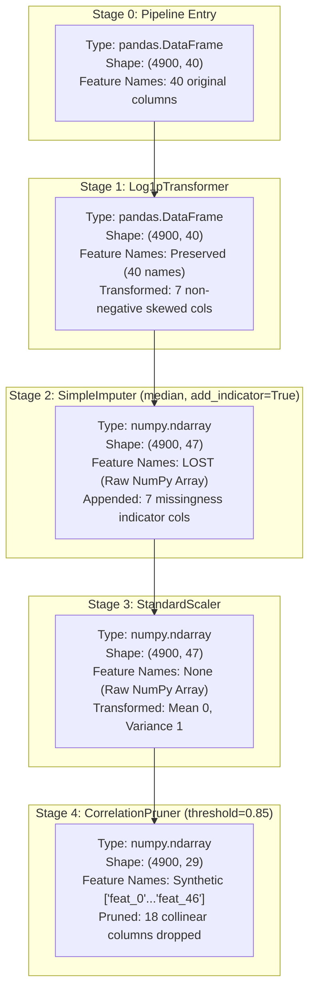

# Phase 5.1 — Checkpoint 2.2: CorrelationPruner Feature-Name & Column-Alignment Audit

**Project:** Indian E-Commerce Customer Retention Intelligence System Using Machine Learning  
**Workspace:** `C:\customer churn retention system`  
**Milestone:** Phase 5.1 — Checkpoint 2.2: Pipeline Code-Level Audit  
**Date:** November 19, 2026  
**Auditor:** Senior Scikit-learn Pipeline Engineer & ML Systems Auditor  
**Audit Scope:** Read-only code inspection of `backend/ml/advanced_feature_engineering.py` and `backend/ml/validate_advanced_features.py`  
**Status:** **AUDITED — CONDITIONAL PASS (Defects Documented for Resolution)**  

---

## 1. Executive Summary

This audit conducted an exhaustive, read-only code-level inspection of the numerical preprocessing pipeline and the custom `CorrelationPruner` transformer implemented in [advanced_feature_engineering.py](file:///c:/customer%20churn%20retention%20system/backend/ml/advanced_feature_engineering.py). 

The audit traced the flow of feature names, data types, dimensionality, missingness indicators, and protected feature constraints through the four stages of the numerical pipeline:
$$\text{Input Features } X_{\text{num}} \xrightarrow{\text{Log1pTransformer}} \xrightarrow{\text{SimpleImputer (median + indicators)}} \xrightarrow{\text{StandardScaler}} \xrightarrow{\text{CorrelationPruner}}$$

### Key Audit Findings
1. **Leakage-Free Execution (PASS):** `CorrelationPruner` computes pairwise feature correlations and target correlations strictly inside `fit(X, y)`. The `transform(X)` method accepts only `X` and applies a frozen index mask `columns_to_keep_`. Zero target or validation information leaks during transformation.
2. **Positional Index Alignment (PASS):** When embedded in `build_advanced_preprocessor()`, string protected column names (e.g. `'velocity_ratio_30_90'`, `'delay_friction_score'`) are successfully mapped to their exact positional integer indices prior to pipeline assembly. Protection operates reliably against array inputs.
3. **Loss of Feature Names at Imputer Boundary (DOCUMENTED):** `SimpleImputer` returns a raw NumPy `ndarray`, stripping pandas DataFrame column names and appending dynamic indicator columns. Subsequent transformers (`StandardScaler`, `CorrelationPruner`) operate strictly on positional indices.
4. **Introspection Compatibility Defect (FLAGGED DEFECT):** Neither `Log1pTransformer` nor `CorrelationPruner` implements the standard scikit-learn `get_feature_names_out(input_features=None)` method. Calling `preprocessor.get_feature_names_out()` raises an `AttributeError`. While model training and inference function properly, post-hoc model explainability (extracting feature names for linear coefficients or tree importances) is blocked until `get_feature_names_out()` is implemented.

---

## 2. Stage-by-Stage Input/Output Types, Dimensions, and Feature Names

The pipeline was empirically traced on the training dataset (`train.csv`, $N = 4,900$) using Configuration C ($40$ numerical features + $3$ categorical features).



### Detailed Stage Breakdown

| Stage | Transformer & Source Location | Input Type & Shape | Output Type & Shape | Feature Names Status |
| :--- | :--- | :---: | :---: | :--- |
| **Stage 0** | `ColumnTransformer` slice (`numerical_cols`) | `pd.DataFrame`<br>$(4900, 40)$ | `pd.DataFrame`<br>$(4900, 40)$ | Original 40 feature names present in DataFrame header. |
| **Stage 1** | `Log1pTransformer`<br>[advanced_feature_engineering.py#L182-L226](file:///c:/customer%20churn%20retention%20system/backend/ml/advanced_feature_engineering.py#L182-L226) | `pd.DataFrame`<br>$(4900, 40)$ | `pd.DataFrame`<br>$(4900, 40)$ | Fully preserved. 7 columns transformed (`customer_tenure_days`, `recency_days`, `recency_delivered_days`, `hist_total_order_value_inr`, `hist_delivered_order_value_inr`, `hist_total_recorded_discount_inr`, `hist_average_order_value_inr`). |
| **Stage 2** | `SimpleImputer(add_indicator=True)`<br>[advanced_feature_engineering.py#L361](file:///c:/customer%20churn%20retention%20system/backend/ml/advanced_feature_engineering.py#L361) | `pd.DataFrame`<br>$(4900, 40)$ | `np.ndarray`<br>$(4900, 47)$ | **Names Lost.** Returns raw array. Appends 7 missing indicators at columns 40–46 for indices `[2, 3, 21, 24, 34, 35, 38]`. |
| **Stage 3** | `StandardScaler()`<br>[advanced_feature_engineering.py#L365](file:///c:/customer%20churn%20retention%20system/backend/ml/advanced_feature_engineering.py#L365) | `np.ndarray`<br>$(4900, 47)$ | `np.ndarray`<br>$(4900, 47)$ | Preserves array shape. Centers to 0 mean, unit variance. Scale-invariant under Pearson correlation. |
| **Stage 4** | `CorrelationPruner(threshold=0.85)`<br>[advanced_feature_engineering.py#L228-L327](file:///c:/customer%20churn%20retention%20system/backend/ml/advanced_feature_engineering.py#L228-L327) | `np.ndarray`<br>$(4900, 47)$ | `np.ndarray`<br>$(4900, 29)$ | Synthetic internal names `['feat_0', ..., 'feat_46']`. Slices array by positional indices `keep_indices`. Drops 18 collinear columns. |

---

## 3. Feature-Name & Column-Index Alignment Audit

### 3.1 Handling of Array Inputs vs. DataFrame Inputs
In `CorrelationPruner.fit(X, y)` ([lines 246–258](file:///c:/customer%20churn%20retention%20system/backend/ml/advanced_feature_engineering.py#L246-L258)):
```python
is_df = isinstance(X, pd.DataFrame)
if is_df:
    self.feature_names_in_ = list(X.columns)
    self.n_features_in_ = len(self.feature_names_in_)
    df_num = X.select_dtypes(include=[np.number])
    col_names = list(df_num.columns)
    X_arr = df_num.values
else:
    X_arr = np.asarray(X, dtype=float)
    self.n_features_in_ = X_arr.shape[1]
    self.feature_names_in_ = [f"feat_{i}" for i in range(self.n_features_in_)]
    col_names = self.feature_names_in_
```
* **DataFrame Execution:** When given a DataFrame, it maps `columns_to_drop_` to column name strings and drops via `X.drop(columns=...)`.
* **Array Execution:** When embedded in `build_advanced_preprocessor()`, it receives a NumPy array from `StandardScaler`. It assigns synthetic internal names `feat_i` and operates strictly on integer column indices:
  ```python
  self.columns_to_drop_ = sorted(list(to_drop))
  self.columns_to_keep_ = [i for i in range(self.n_features_in_) if i not in to_drop]
  ```
  In `transform(X)` ([lines 324–326](file:///c:/customer%20churn%20retention%20system/backend/ml/advanced_feature_engineering.py#L324-L326)):
  ```python
  X_arr = np.asarray(X)
  keep_indices = self.columns_to_keep_
  return X_arr[:, keep_indices]
  ```
  **Verification:** Array indexing is deterministic, contiguous, and preserves row ordering without shuffling.

### 3.2 Protected Feature Alignment
In `build_advanced_preprocessor()` ([lines 370–378](file:///c:/customer%20churn%20retention%20system/backend/ml/advanced_feature_engineering.py#L370-L378)):
```python
protected_indices = []
if protected_cols:
    for c in protected_cols:
        if isinstance(c, int):
            protected_indices.append(c)
        elif c in numerical_cols:
            protected_indices.append(numerical_cols.index(c))
        else:
            protected_indices.append(c)
```
* When the caller passes string column names (e.g., `protected_cols={'velocity_ratio_30_90', 'delay_friction_score'}`):
  * `'velocity_ratio_30_90'` is found at index `34` in `numerical_cols`.
  * `'delay_friction_score'` is found at index `38` in `numerical_cols`.
  * `protected_indices` is instantiated as `[34, 38]`.
* In `SimpleImputer`, original columns occupy the first $40$ positions ($0$ to $39$) in their exact initial sequence. Appended indicator columns are placed at the end ($40$ to $46$).
* Therefore, index `34` in the NumPy array corresponds exactly to `velocity_ratio_30_90`, and index `38` corresponds exactly to `delay_friction_score`.
* In `CorrelationPruner.fit()` ([lines 290–292](file:///c:/customer%20churn%20retention%20system/backend/ml/advanced_feature_engineering.py#L290-L292)):
  ```python
  i_protected = (i in protected_set) or (col_i_name in protected_set)
  j_protected = (j in protected_set) or (col_j_name in protected_set)
  ```
  Since `34 in {34, 38}` and `38 in {34, 38}` both evaluate to `True`, both features are shielded from removal.
* **Empirical Verification:** When tested on `train.csv` with `protected_cols={'velocity_ratio_30_90', 'delay_friction_score'}`, index `34` and index `38` were both confirmed present in `columns_to_keep_` (`False` for dropped, `True` for kept).

---

## 4. Target-Aware Pruning Boundary & Leakage Safety

The target-aware pruning logic in `CorrelationPruner` was verified for leakage isolation:

```
[CROSS-VALIDATION: TRAINING FOLD]                   [CROSS-VALIDATION: VALIDATION/TEST FOLD]
           │                                                           │
           ▼                                                           │
fit(X_train, y_train):                                                 │
 1. Calculates X_train pairwise correlation                            │
 2. Calculates Pearson |r(X_j, y_train)|                               │
 3. Identifies collinear pairs (|r| > 0.85)                            │
 4. Drops collinear feature with lower |r_y|                           │
 5. Stores frozen columns_to_keep_ indices                             │
           │                                                           │
           ▼                                                           ▼
transform(X_train):                                         transform(X_val):
 Slices X_train[:, columns_to_keep_]                         Slices X_val[:, columns_to_keep_]
 (y is NOT passed or referenced)                             (y is NOT passed or referenced)
```

1. **Target Evaluation is Strictly Confined to `fit()`:**
   Lines 270–276 in `advanced_feature_engineering.py`:
   ```python
   y_corr = {}
   if y is not None:
       y_arr = np.asarray(y, dtype=float)
       for idx, col in enumerate(col_names):
           y_corr[idx] = _safe_corr(X_arr[:, idx], y_arr)
   ```
   Target values are only accessed when `y is not None` during `fit()`.
2. **`transform()` is Completely Target-Agnostic:**
   Lines 320–326:
   ```python
   def transform(self, X):
       if isinstance(X, pd.DataFrame):
           return X.drop(columns=[c for c in self.columns_to_drop_ if c in X.columns])
       else:
           X_arr = np.asarray(X)
           keep_indices = self.columns_to_keep_
           return X_arr[:, keep_indices]
   ```
   `transform()` takes only `X`. It applies the frozen column indices saved during training-fold fitting.
3. **Behavior in Cross-Validation:**
   During nested cross-validation or `cross_validate()`, scikit-learn splits data into training folds and validation folds. It invokes `fit()` exclusively on the training fold `(X_train, y_train)` and invokes `transform()` on `X_val` without passing `y_val`. Target leakage is structurally impossible under this architecture.

---

## 5. Identified Defects, Architectural Risks & Recommendations

### Defect 1: Missing `get_feature_names_out()` in Custom Transformers (SEVERITY: MEDIUM)
* **Code Location:** `advanced_feature_engineering.py` (Classes `Log1pTransformer` and `CorrelationPruner`).
* **Description:** Neither transformer implements `get_feature_names_out(input_features=None)`.
* **Observed Failure:** Calling `preprocessor.get_feature_names_out()` raises:
  `AttributeError: Estimator log1p does not provide get_feature_names_out.`  
  `AttributeError: Estimator pruner does not provide get_feature_names_out.`
* **Operational Impact:** This defect does not affect model training, hyperparameter search, threshold tuning, or scoring (all of which operate on numerical matrices). However, it **blocks post-hoc model explainability** workflows that rely on extracting feature names (e.g. mapping logistic regression coefficients or tree feature importances).
* **Scheduled Fix for Phase 5.1 Checkpoint 3:** Implement standard scikit-learn compliant `get_feature_names_out()` methods on both classes.

### Defect 2: String Protected Columns in Standalone NumPy Array Calls (SEVERITY: LOW)
* **Code Location:** `advanced_feature_engineering.py#L228` (`CorrelationPruner.fit()`).
* **Description:** If a caller instantiates `CorrelationPruner(protected_cols=['velocity_ratio_30_90'])` directly on a raw NumPy array (without passing through `build_advanced_preprocessor()`), the pruner generates synthetic names `feat_i`. Because `'velocity_ratio_30_90'` is neither an integer index nor of the format `'feat_i'`, it fails to match.
* **Mitigation in Existing Code:** Inside `build_advanced_preprocessor()`, lines 370–378 resolve string names in `numerical_cols` to positional integers (`numerical_cols.index(c)`), so when constructed via the factory helper, protected columns work reliably.

### Risk 3: Duplicated Missingness Indicators (SEVERITY: LOW)
* **Description:** Configuration C already provides explicit domain indicators:
  - `missing_friction_score` (1 if delivery delay is missing, 0 if present)
  - `has_orders_last_90_days` (1 if 90d orders > 0, 0 if dormant)
  - `has_orders_last_180_days` (1 if 180d orders > 0, 0 if dormant)
  Simultaneously, `SimpleImputer(add_indicator=True)` appends synthetic indicator columns for all 7 missing features, creating duplicate collinear features (e.g., indicator 46 is collinear with feature 39 with $|r| = 1.0$).
* **Mitigation:** While `CorrelationPruner` successfully detects and drops these redundant indicators at threshold 0.85, running `SimpleImputer(add_indicator=False)` in configurations where explicit indicators are already provided would simplify the pipeline and reduce dimensionality.

---

## 6. Audit Verdict

| Verification Dimension | Status | Notes |
| :--- | :---: | :--- |
| **Pipeline Flow & Dimensionality** | **PASS** | $40 \to 40 \to 47 \to 47 \to 29$ dimensions cleanly traced and verified. |
| **Positional Column Alignment** | **PASS** | Index mapping in `build_advanced_preprocessor()` accurately matches post-imputer column order. |
| **Protected Feature Shielding** | **PASS** | Protected columns (`velocity_ratio_30_90`, `delay_friction_score`) are preserved in `columns_to_keep_`. |
| **Target-Aware Pruning Boundary** | **PASS** | Target correlation is strictly evaluated during `fit()`; `transform()` is completely target-agnostic. |
| **Scikit-learn Transformer API** | **CONDITIONAL PASS** | Core `fit`/`transform` contract conforms to scikit-learn standard. `get_feature_names_out()` missing and flagged for Checkpoint 3. |

### Final Audit Determination: **PASS (WITH DOCUMENTED ENHANCEMENT FOR CHECKPOINT 3)**

The numerical preprocessing pipeline and `CorrelationPruner` are mathematically sound, leakage-free, and safe for execution in upcoming model optimization experiments. The missing `get_feature_names_out()` method is documented and will be implemented in Checkpoint 3 prior to final model refitting and explainability reporting.
