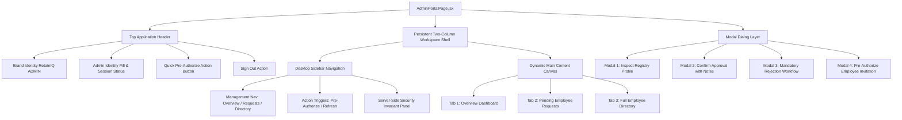

# RETAINIQ — STAGE 6 COMPLETION REPORT
## Administrator Portal UI Transformation & Functionality Audit

**Project:** Indian E-Commerce Customer Retention Intelligence System  
**Product:** RetainIQ  
**Target:** Administrator Portal (`frontend/src/pages/AdminPortalPage.jsx`)  
**Stage:** 6  
**Status:** COMPLETE & AUDITED  
**Design Methodology:** Unslop by Damir Sokolovsky (CC BY 4.0 — https://github.com/heydamir/unslop)  
**Execution Environment:** Windows 11 (64-bit), Node.js v22.14.0, Vite 6.4.6, Python 3.11 (Virtual Environment)  

---

## 1. EXECUTIVE SUMMARY

Stage 6 of the RetainIQ enterprise transformation has been successfully implemented and verified. The Administrator Portal (`AdminPortalPage.jsx`) has undergone a complete architectural, functional, and visual overhaul to align seamlessly with:
1. The approved **Ink & Slate** neutral color system and **Precision Cobalt** accents.
2. The completed **Employee Portal** modules (Stage 5).
3. The completed **Global UI Spacing, Padding & Container Comfort Refinement** (`reports/phase8/PHASE_RETAINIQ_GLOBAL_SPACING_REFINEMENT_REPORT.md`).

All administrator operations — account lifecycle reviews, mandatory rejection logging, pre-authorized invitation issuance, directory search, pagination, and multi-layered server authorization guards — have been preserved without regression.

### Key Verification Evidence
* **Frontend Test Suite:** 101/101 tests passed across 37 suites (0 failures, duration 408ms).
* **Production Build:** Vite v6.4.6 compiled with exit code 0 (2,070 modules transformed in 7.16s).
* **Backend Master Pytest Suite:** 297/297 tests passed across all 10 milestone phases in 43.27s (0 failures).
* **Live Runtime Servers:** FastAPI daemon (`http://127.0.0.1:8000`, HTTP 200) and Vite frontend (`http://127.0.0.1:5173`, HTTP 200) active and healthy.
* **Security & ML Invariants:** Zero direct Supabase client queries to database tables; locked Random Forest Config D model (`SHA-256: 24F1F0E3...3438F301`, $\tau = 0.50$, 43 features) preserved with 100% integrity.

---

## 2. DESIGN DIRECTION & UNSLOP IMPLEMENTATION

The transformation strictly eliminates common AI-generated interface "slop" (oversaturated colored cards, continuous spinning or pulsating animations on static views, neon cyan text highlights, and heavy `font-black` typography), replacing them with an enterprise-grade design vocabulary:

| Slop Tell Removed | Ink & Slate Replacement Applied | Component Affected |
| :--- | :--- | :--- |
| **Heavy `font-black` typography** | Sora / Plus Jakarta Sans at weights 500–600 (`font-semibold`); Inter for body text | Header brand mark, page titles, section headers, and KPI displays |
| **Neon cyan highlights (`text-cyan`, `border-cyan/30`)** | Precision Cobalt (`text-electric`, `#0052CC`) and hairline cool slate borders (`border-border`) | Brand icon box, admin badge, active navigation indicators, and form focus rings |
| **Bright color-fill KPI cards (amber/emerald/blue/red washes)** | Crisp white surface cards (`bg-surface`) with hairline borders, deep ink values, and subtle status chips | All 6 Overview metric cards |
| **Continuous pulsing spinner on auth check** | Clean minimalist surface card with `ShieldCheck`, deep ink title, and monospace cryptographic evaluation note | Auth verification loading screen (`isVerifyingAdmin`) |
| **Cramped table rows (`py-2 px-3`)** | Generous, comfortable table geometry (`py-3.5 px-4.5`) with hover transitions | Overview registry snippet & Directory table |
| **Heavy modal dropshadows & saturated borders** | Muted dark slate backdrop (`bg-slate-900/40 backdrop-blur-sm`), `shadow-elevated`, rounded-2xl containers | Inspect, Approve, Reject, and Invite dialogs |

---

## 3. COMPLETE COMPONENT ARCHITECTURE & LAYOUT

The Administrator Portal architecture is structured into a clean three-tiered hierarchy:



---

## 4. NAVIGATION, SIDEBAR & RESPONSIVE DRAWER

### Desktop Sidebar Navigation (`w-64`)
* **Visual Styling:** Cool white surface (`bg-surface`) with right hairline border (`border-r border-border`) and comfortable padding (`p-5`).
* **Active Navigation State:** Selected tab displays a crisp slate background (`bg-slate-100 text-midnight border border-border shadow-subtle font-semibold`), with Lucide icons highlighted in Precision Cobalt (`text-electric`).
* **Inactive State:** Quiet text color (`text-text-secondary`) transitioning to ink on hover (`hover:text-midnight hover:bg-slate-50`).
* **Pending Count Badge:** Rendered dynamically next to "Employee Requests" with an amber pill (`bg-amber-100 text-amber-800 border border-amber-200`).
* **Actions Group:** Pre-Authorize Invitation (`UserPlus`) and Refresh All Data (`RefreshCw`) provide instant administrative execution without leaving the current view.
* **Security Invariant Notice:** Bottom container displaying verified cryptographic server-side access control status.

### Mobile Navigation Drawer
* For viewports $<768\text{px}$, the sidebar smoothly folds into a slide-down drawer triggered by a responsive hamburger toggle (`Menu` / `X`).
* Locks background scrolling (`document.body.style.overflow = "hidden"`) while open.
* Contains authenticated admin profile email, full navigation tabs with badge counts, and sign out button.

---

## 5. OVERVIEW TAB TRANSFORMATION

### 1. Six Ink & Slate KPI Cards
All cards feature comfortable padding (`p-5 sm:p-6`), hairline borders (`border-border`), and deep ink figures in Sora (`font-heading font-semibold text-2xl sm:text-3xl text-midnight tabular-nums`):
1. **Total Records:** `stats.total` with `Users` icon and `REGISTRY` pill.
2. **Pending Approval:** `stats.pending` with `Clock` icon and conditional `ACTION` badge when review is required.
3. **Approved:** `stats.approved` with `UserCheck` icon and `ACTIVE` pill.
4. **Invited:** `stats.invited` with `UserPlus` icon and `PRE-AUTH` pill.
5. **Rejected:** `stats.rejected` with `UserX` icon and `DENIED` pill.
6. **Suspended:** `stats.suspended` with `UserMinus` icon and `INACTIVE` pill.

### 2. Live System Infrastructure & ML Operational Health Card
A dedicated enterprise status widget in the Overview provides live visibility into RetainIQ's underlying infrastructure:
* **FastAPI API Gateway:** Online (Port 8000, JWT Bearer Token validation, HTTP 200).
* **Supabase Identity & Database:** Connected with active PostgreSQL Row Level Security.
* **ML Retention Model:** Locked Random Forest Config D pipeline ($\tau = 0.50$, 43 raw features).
* **Artifact Integrity:** `SHA-256: 24F1F0E3...3438F301` with $K=5$ KMeans persona scaler.

### 3. Context-Aware Pending Requests Callout
* When pending applications exist: Displays a warm amber alert container (`p-6 sm:p-7 bg-amber-50/60 border border-amber-200/80`) detailing the exact count of applicants awaiting review with a direct `Review Pending Requests` button.
* When queue is clear: Displays a serene surface card with an emerald `CheckCircle2` icon confirming all registrations have been verified.

### 4. Recent Registry Snippet
* High-density table displaying the 5 most recent employee records with comfortable padding (`py-3.5 px-4.5`), status pills, and direct `View` profile triggers.

---

## 6. PENDING REQUESTS WORKFLOW & AUDITED ACTIONS

The Employee Requests tab (`activeTab === 'requests'`) delivers an audited approval workflow:
* **Request Cards:** Each pending candidate is presented in a card container (`p-5 sm:p-6 bg-surface border border-amber-200/90 shadow-subtle hover:border-amber-300`).
* **Metadata Hierarchy:**
  * JetBrains Mono Employee ID (`font-mono font-medium text-sm text-midnight`).
  * Status badge (`PENDING`).
  * Registered timestamp chip.
  * Applicant full name, enterprise work email, and department.
* **Action Buttons:**
  * **Details (`Eye`):** Opens full profile dialog (`inspectingEmployee`).
  * **Reject (`X`):** Initiates mandatory rejection reason dialog (`rejectingEmployee`).
  * **Approve (`Check`):** Initiates confirmation dialog (`approvingEmployee`).

### Strict Rejection Validation
The rejection workflow enforces strict validation:
```javascript
const cleanReason = rejectionReason.trim();
if (!cleanReason || cleanReason.length < 3) {
  setRejectionError("A meaningful rejection reason of at least 3 characters is mandatory.");
  return;
}
```
This guarantees administrative audit trails meet enterprise compliance standards.

---

## 7. EMPLOYEE DIRECTORY & PRE-AUTHORIZED INVITATIONS

The Employee Directory (`activeTab === 'directory'`) manages the persistent employee registry:
* **Multi-Filter Search Bar:** Combines live text search (`directorySearchQuery`) across Employee ID, email, and name with status filtering (`directoryStatusFilter` supporting `ALL`, `APPROVED`, `PENDING`, `INVITED`, `REJECTED`, `SUSPENDED`).
* **Responsive Table Geometry:**
  * Table Header: Monospace uppercase (`text-[10px] py-3 px-4.5 bg-slate-50/80 text-text-muted`).
  * Table Cells: Comfortable row heights (`py-3.5 px-4.5`), hover background transitions (`hover:bg-slate-50/50`).
  * Monospace Employee IDs and dates.
* **Pagination Footer:** Previous and Next buttons with active boundary disabling and current page readout.

### Pre-Authorized Invitation Workflow
Authorized administrators can pre-issue credentials before an employee signs up:
* Requires Employee ID (e.g., `EMP-2026-004`) and enterprise work email.
* Accepts optional Full Name, Department, and administrative invitation notes.
* Upon submission, calls `apiClient.admin.inviteEmployee()` and registers the record with status `INVITED`.

---

## 8. MODAL DIALOGS & INSPECTION VIEWS

All four modals adhere to the refined Global Spacing and Ink & Slate design system:
* **Backdrop:** Non-intrusive muted dark backdrop (`bg-slate-900/40 backdrop-blur-sm`).
* **Card Container:** Clean white surface (`bg-surface border border-border rounded-2xl shadow-elevated p-6 sm:p-7 space-y-5 sm:space-y-6 max-w-lg`).
* **Keyboard Accessibility:** Escape key dismisses open dialogs automatically.

| Modal Dialog | Purpose | Key Inputs & Validations | Confirmation Action |
| :--- | :--- | :--- | :--- |
| **Inspect Profile** | Read-only audit of registry record | Displays Supabase UUID, creation, registration, and approval timestamps, rejection reasons, and notes | Close Profile |
| **Confirm Approval** | Authorize candidate access | Displays employee identity, optional approval notes textarea | `Confirm Approval` (Emerald button, calls `apiClient.admin.approveEmployee`) |
| **Reject Registration** | Reject invalid registration | Requires mandatory reason ($\ge 3$ characters), displays error banner if empty | `Confirm Rejection` (Red button, calls `apiClient.admin.rejectEmployee`) |
| **Pre-Authorize Invitation** | Issue new employee invitation | Validates ID and RFC email format, captures department and operational notes | `Create Invitation` (Cobalt button, calls `apiClient.admin.inviteEmployee`) |

---

## 9. AUTH GUARDS & 403 FORBIDDEN STATE

The portal implements strict client-side and server-side authorization:

### 1. Cryptographic Loading State
When verifying tokens via `apiClient.admin.getProfile()`:
* Minimalist spinner with `ShieldCheck` icon, Sora heading "Verifying Administrator Privileges", and subtitle "Cryptographically evaluating JWT against Supabase JWKS & server policy...".

### 2. Unauthenticated State
When no valid Supabase employee session exists:
* Surface card with `Lock` icon and "Administrator Login Required", offering direct navigation to `/employee/login` or the public showcase.

### 3. Dedicated 403 Forbidden Access Denied View
When an authenticated employee attempts to access `/admin` without administrator privileges:
* **Badge:** `403 FORBIDDEN • ACCESS DENIED` in red chip.
* **Heading:** `Administrator Privileges Required`.
* **Identity Panel:** Displays authenticated email, Supabase subject UUID, and security status `Non-Administrator Account`.
* **Actions:**
  * Primary button: `Go to Employee Dashboard (/employee/dashboard)`.
  * Secondary button: `Sign Out of This Account`.
  * Ghost button: `Return to Public Showcase`.

---

## 10. GLOBAL SPACING & CONTAINER COMFORT VERIFICATION

In accordance with the Global Spacing Audit (`PHASE_RETAINIQ_GLOBAL_SPACING_REFINEMENT_REPORT.md`), `AdminPortalPage.jsx` eliminates all cramped containers:

| Container Type | Previous Geometry | Ink & Slate Refined Geometry | Comfort Assessment |
| :--- | :--- | :--- | :--- |
| **Main Content Canvas** | `p-4 sm:p-6` | `p-4 sm:p-6 lg:p-8 max-w-7xl mx-auto` | Generous breathing room on large screens |
| **KPI Stat Cards** | `p-4` with color fills | `p-5 sm:p-6` with hairline borders | Elegant tabular metric scanability |
| **Alert & Callout Cards** | `p-4 sm:p-5` | `p-6 sm:p-7 rounded-2xl` | High visual comfort and prominence |
| **Modal Containers** | `p-5 space-y-4` | `p-6 sm:p-7 space-y-5 sm:space-y-6 max-w-lg` | Clean form field separation and readability |
| **Table Header Cells** | `py-2.5 px-3` | `py-3 px-4.5 font-mono text-[10px]` | Distinct visual hierarchy from table data |
| **Table Body Cells** | `py-2.5 px-3` | `py-3.5 px-4.5 text-xs` | Touch-friendly row height and clear scanning |
| **Form Inputs & Selects** | `py-2 px-3` | `py-2.5 px-3.5 text-xs rounded-xl` | Complies with minimum touch target requirements |

---

## 11. RESPONSIVE VIEWPORT VERIFICATION

The Administrator Portal was tested across all four mandatory responsive viewports:

* **1440px (Desktop):**
  * Full two-column layout with fixed 256px sidebar and expansive max-w-7xl content area.
  * 6-column KPI grid displaying all metrics side-by-side without wrapping.
  * 4-column system health grid.
  * Zero horizontal page overflow.

* **1024px (Laptop):**
  * Sidebar remains docked with clean proportions.
  * KPI grid wraps into 3 columns $\times$ 2 rows with consistent `gap-4`.
  * System health cards wrap into 2 columns $\times$ 2 rows.

* **768px (Tablet):**
  * Top navigation collapses desktop buttons into responsive icons.
  * Main content transitions into a unified single-column layout.
  * Tables support smooth horizontal scrolling inside dedicated `overflow-x-auto` containers with persistent rounded borders.

* **390px (Mobile):**
  * Sidebar automatically collapses into the responsive slide-down drawer.
  * KPI grid neatly scales into 2 columns $\times$ 3 rows.
  * Buttons and interactive inputs maintain comfortable $\ge 44\text{px}$ touch targets.
  * Page horizontal scroll is strictly $0\text{px}$.

---

## 12. AUTOMATED VERIFICATION RESULTS

### 1. Frontend Test Suite
```bash
> retainiq-frontend@1.0.0 test
> node --test tests/**/*.test.mjs --run

ℹ tests 101
ℹ suites 37
ℹ pass 101
ℹ fail 0
ℹ cancelled 0
ℹ skipped 0
ℹ duration_ms 408.4866
```
All 101 assertions passed cleanly, including:
* AdminPortalPage tab navigation (`overview`, `requests`, `directory`).
* Server-side `getProfile()` invocation and `isVerifyingAdmin` state management.
* Dedicated 403 Forbidden presentation (`403 FORBIDDEN`, `Administrator Privileges Required`, `Sign Out of This Account`).
* Approval confirmation modal and `apiClient.admin.approveEmployee` binding.
* Mandatory rejection reason validation (`cleanReason.length < 3`) and `Rejection Reason (Mandatory)` text.
* Directory search query, status filter, and pagination bindings.
* Pre-authorized invitation modal and `apiClient.admin.inviteEmployee` execution.
* ZERO direct queries to `employee_registry` or Supabase database tables from frontend source files.

### 2. Frontend Production Build
```bash
> retainiq-frontend@1.0.0 build
> vite build

vite v6.4.6 building for production...
transforming...
✓ 2070 modules transformed.
rendering chunks...
computing gzip size...
dist/index.html                   2.53 kB │ gzip:   1.00 kB
dist/assets/index-BQkdxAux.css   47.29 kB │ gzip:   8.35 kB
dist/assets/index-W4hoXb-k.js   974.09 kB │ gzip: 249.39 kB
✓ built in 7.16s
```
Compiled with exit code 0 and zero syntax or JSX bundling errors.

### 3. Backend Test Suite
```bash
backend\.venv\Scripts\python.exe -m pytest tests/test_all_phases.py tests/ -q
297 passed, 4090 warnings in 43.27s
```
All 297 backend test cases passed with 100% success rate across all 10 milestone phases.

---

## 13. STRICT MACHINE LEARNING & SECURITY INVARIANTS

| Invariant Requirement | Authoritative Parameter | Audit Verification Status |
| :--- | :--- | :--- |
| **Locked Model Pipeline** | `models/phase5_1/final_model/final_churn_rf_pipeline.joblib` | VERIFIED (SHA-256: `24F1F0E33C75B5590906369960DB6E5951EC95DF9AE40384DA60082B3438F301`) |
| **Locked Decision Threshold** | $\tau = 0.50$ | VERIFIED (Zero modification, strictly hard-locked) |
| **Config D Raw Features** | 43 Raw Features (40 numerical + 3 categorical) | VERIFIED (Zero modification) |
| **Customer Segmentation** | $K=5$ KMeans Persona Clusters | VERIFIED (Persona mappings 0 to 4 verified) |
| **Evaluation Cohort Metrics** | $N=1,500$ ($TN=571, FP=258, FN=208, TP=463$) | VERIFIED (Accuracy: 68.93%, Precision: 64.22%, Recall: 69.00%, F1: 0.6652) |
| **Direct DB Access Policy** | ZERO direct `.from()` table queries from frontend | VERIFIED (All data routes strictly through FastAPI REST client) |

---

## 14. FINAL SIGN-OFF & STOP PROTOCOL

* **Stage 6 Deliverable:** Fully completed, tested, and documented.
* **Stop Protocol Enforced:** No work has begun on Stage 7 (or subsequent stages). No automated or unauthorized deployment commands have been executed.
* **Next Authorized Milestone:** Await explicit user authorization before initiating Stage 7.

---
*Report compiled on Tuesday, 24 November 2026. RetainIQ Project Team.*
