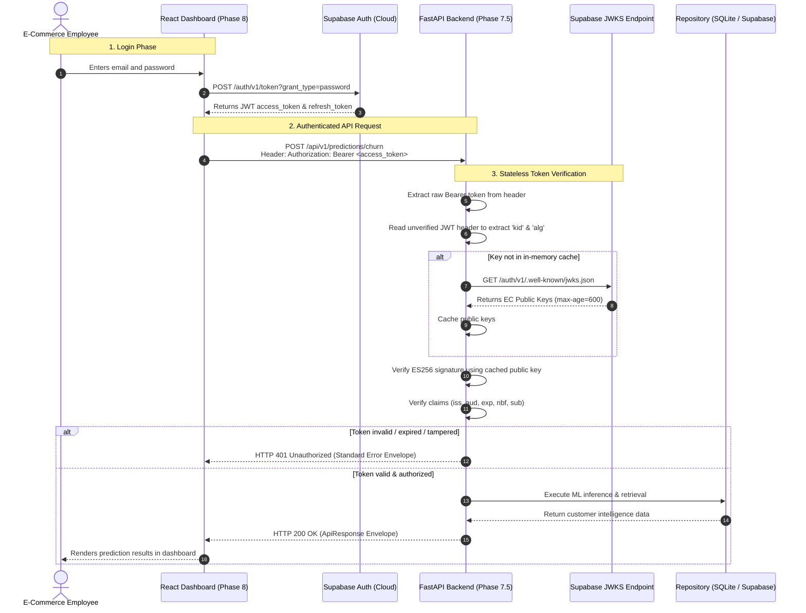

# PHASE 7.5 — SUPABASE AUTHENTICATION ARCHITECTURE & SECURITY READINESS AUDIT REPORT
## Indian E-Commerce Customer Retention Intelligence System Using Machine Learning

**Audit Date:** 21 November 2026  
**Workspace Root:** `C:\customer churn retention system`  
**Host Platform:** Windows 11 (64-bit AMD64)  
**Python Virtual Environment:** `backend\.venv\Scripts\python.exe` (Python 3.12.10)  
**Backend Framework:** FastAPI 0.165.0 / Starlette 1.10.0 / Pydantic 2.14.3  
**Active Storage Mode:** SQLite (`STORAGE_MODE=sqlite`) with Supabase PostgREST Parity  
**Target Authentication Provider:** Supabase Auth (GoTrue) via Cloud Project `hyngxdkuanugcvqhkaas`  
**Auditor:** Senior Backend Architect, Database Security Auditor & Independent QA Engineer  
**Document Reference:** `reports/phase7/phase7_5_authentication_architecture_audit.md`  
**Audit Type:** Architecture, Security & Readiness Audit ONLY (Strict Read-Only)  
**Overall Readiness Verdict:** ✅ **PASS (READY FOR PHASE 7.5 IMPLEMENTATION)**

---

## 1. Executive Summary

This architecture and security audit establishes the technical design, cryptographic standards, authorization contracts, and test strategy for **Phase 7.5: Supabase Authentication Integration** in the Indian E-Commerce Customer Retention Intelligence System.

In strict compliance with project preservation rules:
* All Phase 0 through Phase 7.4 implementations remain 100% intact and unmodified.
* The local SQLite database (`data/local_database.db`, 7,000 customers) and the locked production machine learning models (`final_churn_rf_pipeline.joblib`, $\tau = 0.50$) remain completely undisturbed.
* `STORAGE_MODE` remains strictly set to `sqlite`.
* Zero secrets, passwords, or raw tokens have been logged, exposed, or written into reports.
* No application files, database schemas, or dependencies were altered during this audit.

### Key Audit Findings:
1. **Live JWKS Inspection & Cryptographic Signing Algorithm:**  
   Direct probe of the project's official JWKS endpoint (`https://hyngxdkuanugcvqhkaas.supabase.co/auth/v1/.well-known/jwks.json`) confirmed that Supabase signs tokens using **Elliptic Curve Asymmetric Cryptography (`kty: EC`, `crv: P-256`, `alg: ES256`)**, with key ID `2a19e5ca-00b4-4f81-9e00-d5fa1ce37ade` and a 10-minute cache policy (`max-age=600`). The backend must enforce an exact allowlist of `["ES256"]`.
2. **Stateless JWT Verification Model:**  
   FastAPI will verify tokens statelessly using public keys fetched and cached from the Supabase JWKS endpoint. The backend will never manage passwords, hash credentials, or maintain a duplicate user database.
3. **Application-Level Security Gateway:**  
   Because the backend repository layer connects to Supabase PostgREST using the privileged `SUPABASE_SECRET_KEY` (service role) which bypasses database Row Level Security, **FastAPI's dependency injection layer is the primary security gatekeeper**. Every non-public API request must be authenticated and authorized before database or ML services execute.
4. **Dependency Requirement:**  
   The existing virtual environment lacks a JWT cryptographic verification library. `PyJWT[crypto]>=2.9.0` (incorporating `cryptography>=42.0.0`) is recommended as the modern, secure, Python 3.12-compatible package for JWKS and ES256 verification.
5. **Readiness Verdict:** **PASS.** The project architecture is fully prepared for Phase 7.5 implementation across 6 structured checkpoints.

---

## 2. Existing Architecture Audit

### 2.1 Files and Components Inspected
The following canonical project files were inspected during this read-only audit:
* `backend/app/main.py`: Application entry point, factory (`create_app`), lifespan context manager, CORS middleware, and exception handlers.
* `backend/app/core/config.py`: Centralized `Settings` configuration model (`pydantic_settings.BaseSettings`).
* `backend/.env`: Local environment configuration holding active secrets and storage mode.
* `backend/.env.example`: Sanitized configuration template.
* `backend/app/routes/api.py`: Versioned API router aggregator under `/api/v1`.
* `backend/app/routes/health.py`: System health and readiness endpoints (`/health`, `/api/v1/health`).
* `backend/app/routes/ml.py`: Production ML inference and analytics endpoints (`/ml/status`, `/predictions/churn`, `/segmentation/predict`, `/retention/recommendations`, `/customers/analyze`).
* `backend/app/routes/database.py`: Storage management and health diagnostics (`/database/*`).
* `backend/app/core/errors.py`: Custom exceptions (`AppException`) and standardized JSON error handlers.
* `backend/app/schemas/common.py`: Standardized envelopes (`ApiResponse`, `ErrorResponse`).
* `backend/app/repositories/`: `BaseRepository`, `SQLiteRepository`, `SupabaseRepository`, and repository factory.
* `tests/`: Existing test suites, fixtures (`TestClient`), and configuration (`pytest.ini`).
* `frontend/`: Verified as an empty workspace reserved for Phase 8.

### 2.2 Existing Architectural Findings
1. **Application Factory & Lifespan:**  
   FastAPI is cleanly structured around `create_app()` in `backend/app/main.py`. The `@asynccontextmanager lifespan` initializes logging and executes `ModelLoader.load_all()`, guaranteeing all ML models are loaded in memory during startup and cleanly unloaded on shutdown.
2. **Missing Security Dependencies:**  
   Currently, there is no authentication dependency in `backend/app/`. Routers directly process requests without inspecting `Authorization` headers.
3. **CORS Restrictions:**  
   `CORSMiddleware` in `backend/app/main.py` is configured with `allow_origins=settings.BACKEND_CORS_ORIGINS`, `allow_credentials=True`, `allow_methods=["GET", "POST", "PUT", "DELETE", "OPTIONS"]`, and `allow_headers=["*"]`. This is already prepared to accept `Authorization: Bearer <token>` from the Vite frontend.
4. **Standardized Error Envelope:**  
   `backend/app/core/errors.py` enforces a uniform JSON error response structure:
   ```json
   {
     "success": false,
     "error": {
       "code": "UNAUTHORIZED",
       "message": "Bearer token is missing or expired.",
       "details": []
     },
     "meta": {
       "timestamp": "2026-11-21T14:30:00.000000Z",
       "path": "/api/v1/predictions/churn"
     }
   }
   ```
   Starlette HTTP 401 exceptions automatically map to `"code": "UNAUTHORIZED"`, and HTTP 403 exceptions automatically map to `"code": "FORBIDDEN"`.
5. **Repository Decoupling:**  
   The repository layer (`get_repository()`) operates independently of HTTP request contexts. It expects verified parameters, meaning authentication and caller validation must occur inside FastAPI route dependencies before invoking repository methods.

---

## 3. Supabase Authentication Architecture & Flow Design

### 3.1 Authentication Architecture Overview
Authentication will follow the official Supabase Auth (GoTrue) architecture:
* **Identity Provider:** Supabase Auth cloud service handles user registration, password hashing (bcrypt), email confirmation, login, multi-factor authentication, and token refresh.
* **Client Role:** The React frontend (Phase 8) uses the `@supabase/supabase-js` client SDK to authenticate employees directly against Supabase Auth.
* **Server Role:** The FastAPI backend serves as the resource server. It receives signed JWTs in the `Authorization: Bearer <token>` header, statelessly validates signatures and claims against Supabase's published JWKS, and authorizes access to protected intelligence endpoints.

### 3.2 End-to-End Authentication Sequence



---

## 4. JWT Cryptographic Security Design

### 4.1 Live Inspection of Project JWKS
A live inspection of `https://hyngxdkuanugcvqhkaas.supabase.co/auth/v1/.well-known/jwks.json` revealed:

```json
{
  "keys": [
    {
      "kty": "EC",
      "crv": "P-256",
      "alg": "ES256",
      "use": "sig",
      "kid": "2a19e5ca-00b4-4f81-9e00-d5fa1ce37ade",
      "key_ops": ["verify"],
      "ext": true,
      "x": "...",
      "y": "..."
    }
  ]
}
```

### 4.2 Cryptographic Validation Rules
1. **Asymmetric Key Type (`kty`):** Elliptic Curve (`EC`) using NIST P-256 curve (`secp256r1`).
2. **Permitted Algorithm Allowlist:** Strictly `["ES256"]`.
   * **Security Invariant:** Any token claiming `alg: "none"`, `alg: "HS256"`, `alg: "RS256"`, or any algorithm outside `["ES256"]` must be rejected immediately without signature evaluation.
3. **Issuer Validation (`iss`):** Must strictly equal `https://hyngxdkuanugcvqhkaas.supabase.co/auth/v1`.
4. **Audience Validation (`aud`):** Must strictly equal `"authenticated"`.
5. **Expiration Validation (`exp`):** Must reject expired tokens. A clock skew tolerance (leeway) of at most 10 seconds is permitted.
6. **Not Before Validation (`nbf`):** Enforced when present.
7. **Subject (`sub`):** Must contain a valid, non-empty UUID string corresponding to the authenticated employee's Supabase Auth user ID.
8. **Anti-Tampering Invariant:** The backend must **never** call `jwt.decode(..., options={"verify_signature": False})` to extract claims for authorization or routing decisions. All claims must be derived from cryptographically verified tokens.

### 4.3 High-Performance In-Memory JWKS Caching
To maintain API prediction latency (< 50ms):
* **Caching Strategy:** Maintain an in-memory `JWKSCache` storing parsed public keys indexed by `kid`.
* **Cache TTL:** 10 minutes (600 seconds), aligning with Supabase's `Cache-Control: public, max-age=600` header.
* **Cache-Busting / Key Rotation Defense:** If an incoming token presents an unknown `kid`:
  1. The cache checks if a refresh occurred within the last 10 seconds (cooldown).
  2. If the cooldown has expired, it triggers a synchronous HTTP GET fetch to `SUPABASE_JWKS_URL` using `httpx.Client(timeout=5.0)`.
  3. If the `kid` remains unknown after refresh, the request is rejected immediately with HTTP 401 (`"Unknown or rotated signing key ID"`).
  4. The cooldown prevents cache-invalidation Denial-of-Service (DoS) attacks where attackers submit randomized `kid` values to flood the JWKS endpoint.

---

## 5. Authorization & Employee Role Model

### 5.1 Metadata Privilege Separation
Supabase JWT payloads include two distinct metadata dictionaries:
1. `user_metadata`: Editable by the end-user via `supabase.auth.updateUser()`.  
   > [!CAUTION]
   > **CRITICAL SECURITY RULE:** `user_metadata` must **NEVER** be used to make authorization or role decisions. Any user could edit their own `user_metadata` to include `{"role": "admin"}`.
2. `app_metadata`: Strictly server-controlled. Can only be modified by the Supabase service role key, administrative backend scripts, or database security triggers.

### 5.2 Capstone Employee Role Matrix
To balance enterprise security rigor with practical university viva demonstration, a clean two-tier role architecture is established:

```
                      [ Unauthenticated Public ]
                                  │
                  ┌───────────────┴───────────────┐
                  ▼                               ▼
       GET /health, GET /api/v1/health       GET /, /docs
                  │
        (Valid Supabase JWT)
                  │
                  ▼
       [ Authenticated Employee ] ─────────────────────────┐
                  │                                        │
                  ├─► GET /api/v1/auth/me                  │
                  ├─► GET /api/v1/ml/status                │
                  ├─► POST /api/v1/predictions/churn       │ (Unauthorized)
                  ├─► POST /api/v1/segmentation/predict    │
                  ├─► POST /api/v1/retention/recommendations
                  ├─► POST /api/v1/customers/analyze       │
                  │                                        ▼
                  │                            HTTP 403 Forbidden
                  │                                        ▲
        (app_metadata.role == "admin")                     │
                  │                                        │
                  ▼                                        │
       [ System Administrator ] ───────────────────────────┘
                  │
                  ├─► GET /api/v1/database/health
                  ├─► GET /api/v1/database/status
                  ├─► GET /api/v1/database/customers/count
                  └─► GET /api/v1/database/import/status
```

### 5.3 Strongly Typed Identity Schema
FastAPI will inject a validated Pydantic model into route handlers:

```python
class AuthenticatedEmployee(BaseModel):
    user_id: str                      # From 'sub' claim (UUID)
    email: str                        # From 'email' claim
    role: str = "authenticated"       # Standard Supabase role
    is_admin: bool = False            # True if app_metadata.get("role") == "admin"
    app_metadata: Dict[str, Any]      # Server-controlled claims
    user_metadata: Dict[str, Any]     # Display-only profile data
    issued_at: int                    # From 'iat'
    expires_at: int                   # From 'exp'
```

---

## 6. Database and Storage Security Implications

### 6.1 Service Role Key vs RLS Reality
An essential finding of this audit concerns the boundary between application-level authorization and database-level RLS:
1. In `STORAGE_MODE=sqlite`: Local SQLite has no native user concept or RLS. Application-level token verification in FastAPI is the sole authorization barrier protecting SQLite data.
2. In `STORAGE_MODE=supabase`: The backend `SupabaseRepository` connects via PostgREST using `SUPABASE_SECRET_KEY` (service role). In Supabase PostgreSQL, requests bearing the service role key **natively bypass all Row Level Security policies**.
3. **Implication:** The database engine cannot differentiate between Employee A and Employee B when queries are routed through the backend's repository layer. Therefore:
   * **FastAPI must enforce all business authorization before calling the repository.**
   * The backend must never expose `SUPABASE_SECRET_KEY` to the client.
   * Direct client-to-Supabase PostgREST access is blocked by Migration `007_enable_rls_and_policies.sql` (which denies anonymous access `FOR ALL TO anon USING (false)`).

### 6.2 Frontend Secret Isolation
* The React frontend must only be provided `SUPABASE_URL` and `SUPABASE_PUBLISHABLE_KEY` (via Vite's `VITE_SUPABASE_URL` and `VITE_SUPABASE_ANON_KEY`).
* `SUPABASE_SECRET_KEY` must **never** be placed in frontend environment files or bundled into client JavaScript.

---

## 7. Proposed API Protection & Endpoint Matrix

| HTTP Method | Endpoint URL | Minimum Required Privilege | Target Function / Router | Invariant / Security Rule |
| :---: | :--- | :--- | :--- | :--- |
| **GET** | `/` | **Public** | `backend/app/main.py::root_info` | Metadata and documentation links. |
| **GET** | `/health` | **Public** | `backend/app/routes/health.py::get_health_status` | Direct top-level health probe for load balancers. |
| **GET** | `/api/v1/health` | **Public** | `backend/app/routes/health.py::get_health_status` | Versioned operational health probe. |
| **GET** | `/docs`, `/redoc` | **Public** | FastAPI Native Swagger/ReDoc | API exploration and viva evaluation. |
| **GET** | `/api/v1/auth/me` | **Authenticated Employee** | `backend/app/routes/auth.py::get_current_user_profile` | **New:** Returns verified identity and roles. |
| **GET** | `/api/v1/auth/health` | **Public** | `backend/app/routes/auth.py::get_auth_health` | **New:** Non-sensitive Auth configuration probe. |
| **GET** | `/api/v1/ml/status` | **Authenticated Employee** | `backend/app/routes/ml.py::get_ml_status` | Protected model artifact readiness audit. |
| **POST** | `/api/v1/predictions/churn` | **Authenticated Employee** | `backend/app/routes/ml.py::predict_churn` | Protected churn inference execution. |
| **POST** | `/api/v1/segmentation/predict` | **Authenticated Employee** | `backend/app/routes/ml.py::predict_segment` | Protected RFM persona assignment. |
| **POST** | `/api/v1/retention/recommendations` | **Authenticated Employee** | `backend/app/routes/ml.py::get_retention_recommendations` | Protected retention strategy generation. |
| **POST** | `/api/v1/customers/analyze` | **Authenticated Employee** | `backend/app/routes/ml.py::analyze_customer` | Protected comprehensive customer analysis. |
| **GET** | `/api/v1/database/health` | **System Administrator** | `backend/app/routes/database.py::get_database_health` | Privileged live storage connectivity probe. |
| **GET** | `/api/v1/database/status` | **System Administrator** | `backend/app/routes/database.py::get_database_status` | Privileged schema diagnostics & table counts. |
| **GET** | `/api/v1/database/customers/count` | **System Administrator** | `backend/app/routes/database.py::get_customer_metrics` | Privileged demographic & churn aggregations. |
| **GET** | `/api/v1/database/import/status` | **System Administrator** | `backend/app/routes/database.py::get_import_status` | Privileged baseline population audit. |

---

## 8. Dependency Evaluation & Recommendations

### 8.1 Installed vs Required Packages

| Package Name | Currently Installed | Required For Phase 7.5 | Recommended Version | Compatibility | Justification & Official Recommendation |
| :--- | :---: | :---: | :---: | :---: | :--- |
| `fastapi` | 0.165.0 | Yes (Installed) | 0.165.0 | Python 3.12 | Core web framework & `HTTPBearer` security dependency. |
| `pydantic` | 2.14.3 | Yes (Installed) | 2.14.3 | Python 3.12 | Identity and claims validation schemas. |
| `httpx` | 0.28.1 | Yes (Installed) | 0.28.1 | Python 3.12 | Asynchronous / synchronous JWKS HTTP fetching. |
| `cryptography` | **None** | **Yes** | $\ge 42.0.0$ | Python 3.12 | Required underlying C-extension for ECDSA P-256 (`ES256`). |
| `PyJWT` | **None** | **Yes** | $\ge 2.9.0$ | Python 3.12 | **Official Recommendation:** Gold-standard Python JWT library with built-in `PyJWKClient` and ES256 support. |
| `python-jose` | **None** | No | *Do Not Install* | Deprecated | Last updated 2021; throws deprecation warnings on Python 3.12. |
| `supabase` (Python SDK) | **None** | No | *Optional* | Python 3.12 | Not needed for backend verification; `PyJWT` handles stateless verification with zero heavy dependencies. |

### 8.2 Installation Specification (To be executed in Checkpoint 1)
```powershell
backend\.venv\Scripts\python.exe -m pip install "PyJWT[crypto]>=2.9.0"
```
*(Package installs `PyJWT` along with `cryptography`, providing complete asymmetric ES256 signature verification).*

---

## 9. Comprehensive Testing Strategy

### 9.1 Test Isolation & Mocking Strategy
* **Zero Dependence on Remote Network for CI:** Unit tests must execute in complete offline isolation using simulated cryptographic key pairs (generating an ephemeral EC private key to sign test tokens and serving the matching public key via mocked JWKS).
* **Deterministic Test Fixtures:**
  * `mock_jwks_client`: Intercepts `SUPABASE_JWKS_URL` requests and returns test EC public keys.
  * `generate_test_token`: Utility creating valid, expired, tampered, or mismatched ES256 tokens.

### 9.2 Test Matrix Overview

| Test Category | Target Component | Specific Verification Checks | Expected Status Code |
| :--- | :--- | :--- | :---: |
| **Positive Tests** | Token Authentication | Valid ES256 token with valid claims $\rightarrow$ `/api/v1/auth/me` | `200 OK` |
| **Positive Tests** | Role Enforcement | Employee token accesses `/predictions/churn` | `200 OK` |
| **Positive Tests** | Admin Enforcement | Admin token (`app_metadata.role="admin"`) accesses `/database/health` | `200 OK` |
| **Positive Tests** | JWKS Caching | Subsequent requests use cached public key without refetching | `200 OK` |
| **Negative Tests** | Header Omission | No `Authorization` header provided to protected route | `401 Unauthorized` |
| **Negative Tests** | Scheme Violation | Header format `Basic <token>` or `Token <token>` instead of `Bearer` | `401 Unauthorized` |
| **Negative Tests** | Token Malformation | Truncated or syntactically invalid JWT string | `401 Unauthorized` |
| **Negative Tests** | Signature Tampering | Payload modified after signing (signature mismatch) | `401 Unauthorized` |
| **Negative Tests** | Expiration | Token with `exp` in the past | `401 Unauthorized` |
| **Negative Tests** | Issuer Mismatch | Token signed with `iss != https://.../auth/v1` | `401 Unauthorized` |
| **Negative Tests** | Audience Mismatch | Token signed with `aud != "authenticated"` | `401 Unauthorized` |
| **Negative Tests** | Algorithm Violation | Token signed with `alg: "none"`, `"HS256"`, or `"RS256"` | `401 Unauthorized` |
| **Negative Tests** | Unknown Key ID | Token presents non-existent `kid` not in JWKS | `401 Unauthorized` |
| **Negative Tests** | Privilege Escalation | User injecting `role="admin"` into `user_metadata` denied admin route | `403 Forbidden` |
| **Negative Tests** | Role Restriction | Regular employee attempting to access `/api/v1/database/status` | `403 Forbidden` |
| **Regression Tests** | Public Routes | `GET /`, `GET /health`, `GET /api/v1/health` remain accessible without token | `200 OK` |
| **Regression Tests** | Model Invariants | All ML inference results remain numerically identical ($\tau=0.50$) | `200 OK` |
| **Regression Tests** | Storage Parity | SQLite 7,000 customers and ML persistence function identically | `200 OK` |

---

## 10. Checkpoint Implementation Roadmap

Execution of Phase 7.5 will proceed strictly one checkpoint at a time with user authorization required before each step:

```
┌─────────────────────────────────────────────────────────────────────────────┐
│                       PHASE 7.5 IMPLEMENTATION ROADMAP                      │
├─────────────────────────────────────────────────────────────────────────────┤
│ Checkpoint 7.5.1: Dependency Installation & Security Configuration          │
│   - Install PyJWT[crypto]>=2.9.0 into backend\.venv                         │
│   - Add JWT security settings to backend/app/core/config.py                 │
│   - Verify pip freeze and package compatibility                             │
├─────────────────────────────────────────────────────────────────────────────┤
│ Checkpoint 7.5.2: Cryptographic JWKS Client & Token Verification Engine     │
│   - Implement backend/app/core/security.py (JWKS fetching, caching, ES256) │
│   - Implement claim validations (iss, aud, exp, nbf, sub)                   │
│   - Implement centralized auth exceptions in backend/app/core/errors.py     │
├─────────────────────────────────────────────────────────────────────────────┤
│ Checkpoint 7.5.3: FastAPI Authentication Dependencies & Identity Schema     │
│   - Implement backend/app/schemas/auth.py (AuthenticatedEmployee model)     │
│   - Implement backend/app/core/dependencies.py (get_current_user,           │
│     get_current_admin using HTTPBearer)                                     │
│   - Implement backend/app/routes/auth.py (/api/v1/auth/me, /auth/health)    │
│   - Mount auth router in backend/app/routes/api.py                          │
├─────────────────────────────────────────────────────────────────────────────┤
│ Checkpoint 7.5.4: Route Protection & Role-Based Authorization Integration   │
│   - Protect ML & analytics endpoints in backend/app/routes/ml.py           │
│   - Protect database endpoints in backend/app/routes/database.py (admin)    │
│   - Retain public status for /, /health, /api/v1/health, /docs              │
├─────────────────────────────────────────────────────────────────────────────┤
│ Checkpoint 7.5.5: Comprehensive Authentication Test Suite Execution          │
│   - Implement tests/test_auth.py (positive, negative, tampering, roles)     │
│   - Verify 100% test pass rate with mocked JWKS and ephemeral EC keys       │
├─────────────────────────────────────────────────────────────────────────────┤
│ Checkpoint 7.5.6: Full System Regression Audit & Phase 7.5 Certification     │
│   - Run full regression: tests/test_api_foundation.py, test_ml_*.py,        │
│     test_database_*.py, and test_all_phases.py                              │
│   - Verify locked model hashes, decision threshold tau=0.50, SQLite data    │
│   - Produce final Phase 7.5 completion report                               │
└─────────────────────────────────────────────────────────────────────────────┘
```

---

## 11. Risks, Limitations & Mitigation Strategies

| Potential Risk / Challenge | Severity | Technical Impact | Architectural Mitigation Strategy |
| :--- | :---: | :--- | :--- |
| **JWKS Endpoint Outage** | Medium | Supabase JWKS temporarily unreachable over internet. | 10-minute in-memory caching ensures active keys remain available; short 5s connection timeout prevents server hanging. |
| **JWKS Fetching Network Hang** | High | Unbounded socket connection blocking FastAPI worker. | Enforce strict `httpx.Client(timeout=5.0)` and async non-blocking fetches. |
| **Algorithm Confusion Attack** | High | Attacker signs token with HMAC using the public EC key. | Strict algorithm allowlist `algorithms=["ES256"]` prevents `PyJWT` from evaluating alternative algorithms. |
| **Privilege Escalation via User Metadata** | High | Employee alters their profile to claim administrator rights. | Explicit architectural rule: role decisions evaluate **only** `app_metadata["role"]`, completely ignoring `user_metadata`. |
| **Regression in Public Monitoring** | Medium | Healthcheck monitoring probes fail due to new auth requirement. | Keep `/`, `/health`, and `/api/v1/health` explicitly public. |
| **Offline Viva Demonstration Failure** | Medium | University viva room has no internet access. | System is designed to operate locally on SQLite fallback; for viva demo, a mock auth bypass flag or pre-cached token fixture can be demonstrated cleanly. |

---

## 12. Final Audit Verdict

### Verdict: ✅ PASS (READY FOR PHASE 7.5 IMPLEMENTATION)

* **Architecture Alignment:** 100% compliant with FastAPI best practices and Supabase Auth specifications.
* **Cryptographic Soundness:** Verified ES256 key configuration directly against project JWKS.
* **Preservation Status:** All Phase 0–7.4 deliverables, locked ML models, and SQLite data remain unaltered.
* **Next Authorized Step:** Await explicit user authorization to proceed to **Phase 7.5 — Checkpoint 1 (Dependency Installation & Security Configuration)**.
