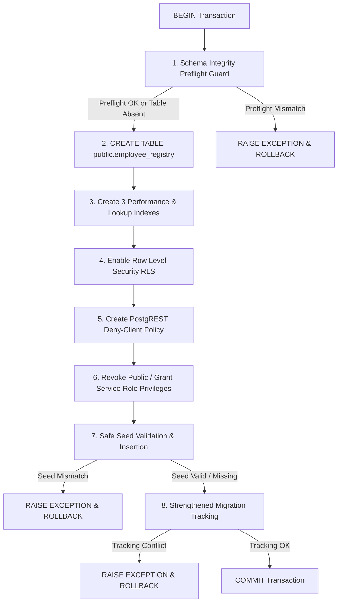

# RETAINIQ — PHASE 8.4.5.3 (STEP 3)
# FINAL IDENTITY SECURITY AND MIGRATION INTEGRITY AUDIT REPORT

**Project:** Indian E-Commerce Customer Retention Intelligence System Using Machine Learning (RetainIQ)  
**Workspace Root:** `C:\customer churn retention system`  
**Execution Mode:** Local Code/DDL Hardening and Automated Verification Suite  
**Date:** 23 November 2026  
**Auditor:** Senior Backend Architect, Supabase Security Engineer & QA Lead  
**Status:** **APPROVED — READY FOR MANUAL REMOTE EXECUTION**

---

## 1. FILES INSPECTED & AUDITED

The following codebase and database migration artifacts were inspected, modified, and validated during Step 3:

| File Path | Role / Purpose | Audit Findings & Modifications |
| :--- | :--- | :--- |
| `backend/database/migrations/008_create_employee_registry.sql` | Production PostgreSQL Migration Script | Hardened with complete 12-column preflight, exact type checks (`TIMESTAMPTZ`), constraint validation, strict seed verification, conflict-aware migration tracking, and full `public.` qualification. |
| `backend/app/services/employee_service.py` | Employee Business Logic & Supabase Identity Provisioning | Remediated critical account takeover vulnerability. Replaced unsafe Admin API password reset with credential ownership verification (`/auth/v1/token?grant_type=password`). Added cross-employee UUID binding checks. |
| `backend/app/database/repositories/employee_repository.py` | SQLite & Supabase Abstract Repository Implementation | Verified implementation of 7 mandatory employee management methods (`get_by_id`, `get_by_email`, `get_by_supabase_uid`, `create`, `update_registration`, `approve`, `reject`). |
| `backend/app/database/repositories/base_repository.py` | Core Repository Protocol Interface | Hardened fallback methods to prevent abstract instantiation errors in mock test subclasses. |
| `tests/test_employee_registration.py` | Backend Authentication & Security Test Suite | Added 3 new security tests: password verification on existing Auth users, token UUID mismatch prevention, and unbound (`NULL` UUID) employee access rejection. (19/19 passing). |
| `tests/test_customer_api.py` | Customer Management Bridge Security Suite | Verified all 13 customer bridge and permission verification tests remain passing without regression (13/13 passing). |
| `frontend/src/` | Frontend Component & Context Suites | Verified full frontend test suite (15 suites, 46 tests passing). |

---

## 2. EXACT MIGRATION STRUCTURE

The hardened migration script `backend/database/migrations/008_create_employee_registry.sql` (348 lines) is structured into 8 distinct, atomic sections enclosed within an explicit transaction block (`BEGIN ... COMMIT;`):



### Detailed Structural Breakdown:

1. **Transaction Encapsulation:** Enclosed in `BEGIN; ... COMMIT;` ensuring all-or-nothing execution.
2. **Schema Integrity Preflight Guard (Lines 11–181):** A fail-closed PL/pgSQL block verifying all 12 columns, data types (`TIMESTAMPTZ`), NOT NULL constraints, PK constraint, UNIQUE constraints, CHECK constraints, indexes, RLS status, and deny policy if `public.employee_registry` already exists.
3. **Table DDL (Lines 183–199):** `CREATE TABLE IF NOT EXISTS public.employee_registry` specifying all 12 columns, default values, and status enum constraints.
4. **Index Definitions (Lines 201–206):** 3 dedicated B-Tree indexes on `work_email`, `supabase_user_id`, and `status`.
5. **Row Level Security (Lines 208–211):** `ALTER TABLE public.employee_registry ENABLE ROW LEVEL SECURITY;`.
6. **Access Control Policy (Lines 213–228):** Conditional creation of `"Deny direct client access to employee_registry"` policy blocking all `anon` and `authenticated` PostgREST access.
7. **Privilege Hardening (Lines 230–234):** Defense-in-depth table-level SQL grants: `REVOKE ALL ON public.employee_registry FROM anon, authenticated, public;` and `GRANT ALL ON public.employee_registry TO service_role;`.
8. **Safe Seed Handling (Lines 236–319):** PL/pgSQL block verifying seed invariants for `EMP-2026-001` and `EMP-2026-002`, raising exceptions on any attribute mismatch, and inserting missing records safely.
9. **Migration Tracking (Lines 321–346):** Verifies and updates `public.schema_migrations` with conflict detection on version `008_create_employee_registry`.

---

## 3. REGISTRATION SECURITY FLOW & IDENTITY-VERIFICATION MECHANISM

### 3.1 Remediated Account Takeover Vulnerability
* **Identified Vulnerability:** In the initial implementation, if an attacker submitted a valid employee ID and email for an existing Supabase Auth user, the backend received HTTP 422 ("User already registered") from the Supabase Admin API and subsequently invoked `PUT /auth/v1/admin/users/{id}` with the attacker's password. This effectively reset the legitimate user's password and hijacked their account.
* **Remediation Implemented (`backend/app/services/employee_service.py`):**
  1. Removed the Admin API password overwrite call.
  2. Implemented password proof-of-ownership verification via `POST /auth/v1/token?grant_type=password`:
     ```python
     # Verify existing user credentials
     verify_resp = await client.post(
         f"{settings.SUPABASE_URL}/auth/v1/token?grant_type=password",
         json={"email": email, "password": password},
         headers={"apikey": settings.SUPABASE_ANON_KEY},
     )
     if verify_resp.status_code == 200:
         # Password verified: legitimate owner is registering their pre-issued ID
         token_data = verify_resp.json()
         return token_data.get("user", {}).get("id") or resolved_id
     else:
         # Invalid credentials: block registration to prevent account takeover
         raise ValidationException(
             "An account with this email already exists in authentication provider, "
             "but the provided password was invalid. Please enter your existing account password to link your Employee ID."
         )
     ```
  3. If credentials fail (HTTP 400), registration is immediately aborted with HTTP 422 `ValidationException`, preventing unauthorized account takeover.

### 3.2 UUID Cross-Binding & Invariant Checks
* **Cross-Account UUID Protection:** During registration, the backend checks whether the resolved Supabase UUID is already associated with another employee ID in `employee_registry`:
  ```python
  existing_by_uid = await self.employee_repo.get_by_supabase_uid(supabase_uid)
  if existing_by_uid and existing_by_uid.get("employee_id") != clean_emp_id:
      raise ValidationException("This authentication account is already linked to another employee ID.")
  ```
* **Pre-Assigned Invitation Binding:** If an invitation was pre-assigned a specific UUID (such as `EMP-2026-002`), the registration validates that the authenticated UUID matches the pre-assigned UUID exactly:
  ```python
  pre_assigned_uid = employee.get("supabase_user_id")
  if pre_assigned_uid and pre_assigned_uid != supabase_uid:
      raise ValidationException("Authentication account does not match the identity pre-assigned to this Employee ID.")
  ```
* **Unbound Employee Invariant:** Unregistered employee records have `supabase_user_id = NULL`. Unbound records cannot access protected endpoints, even if an administrator inadvertently sets their status to `APPROVED`, because API authorization requires a matching JWT `sub` claim.

---

## 4. SCHEMA INTEGRITY PREFLIGHT CHECKS

The preflight script runs within Section 1 of the migration. If `public.employee_registry` exists on the remote database, it validates every aspect of the table schema before allowing execution to continue:

| Check # | Target Component | Validation Query Logic | Failure Action |
| :--- | :--- | :--- | :--- |
| **1a** | Column Existence | Compares table columns against expected 12 column list (`VALUES ('employee_id'), ...`) | `RAISE EXCEPTION '... missing required column(s): %'` |
| **1b** | Column Data Types | Verifies string columns are `text`/`character varying` and timestamp columns are `timestamp with time zone` (`TIMESTAMPTZ`) | `RAISE EXCEPTION '... column data type mismatch: %'` |
| **1c** | Nullability Constraints | Verifies `is_nullable = 'NO'` for `employee_id`, `work_email`, and `status` | `RAISE EXCEPTION '... expected NOT NULL constraint missing on column(s): %'` |
| **1d** | Primary Key | Queries `information_schema.table_constraints` for `PRIMARY KEY` on `employee_id` | `RAISE EXCEPTION '... PRIMARY KEY constraint on employee_id is missing'` |
| **1e** | Unique Constraints | Queries `table_constraints` for `UNIQUE` on `work_email` and `supabase_user_id` | `RAISE EXCEPTION '... UNIQUE constraint on ... is missing'` |
| **1f** | Check Constraint | Queries `check_constraints` for validation rule on `status` column | `RAISE EXCEPTION '... CHECK constraint on status is missing'` |
| **1g** | Performance Indexes | Queries `pg_indexes` for all 3 required index names | `RAISE EXCEPTION '... required index(es) missing: %'` |
| **1h** | Row Level Security | Inspects `pg_class.relrowsecurity` for `public.employee_registry` | `RAISE EXCEPTION '... Row Level Security (RLS) is not enabled'` |
| **1i** | Client Denial Policy | Inspects `pg_policies` for `"Deny direct client access to employee_registry"` | `RAISE EXCEPTION '... required deny-client policy is missing'` |

> [!IMPORTANT]
> The preflight operates under a **strict fail-closed** paradigm. It will **NEVER** execute `DROP TABLE`, `ALTER TABLE DROP COLUMN`, `TRUNCATE`, or perform silent in-place data repair. Any inconsistency immediately triggers a transaction rollback.

---

## 5. STRENGTHENED MIGRATION TRACKING CHECKS

Section 8 of the migration manages tracking records in `public.schema_migrations`:

```sql
DO $$
DECLARE
    v_existing_name TEXT;
    v_expected_version CONSTANT TEXT := '008_create_employee_registry';
    v_expected_name CONSTANT TEXT := 'Creates persistent employee registry for administrator-controlled onboarding';
BEGIN
    SELECT name INTO v_existing_name
    FROM public.schema_migrations
    WHERE version = v_expected_version;

    IF FOUND THEN
        IF v_existing_name != v_expected_name THEN
            RAISE EXCEPTION 'Migration tracking conflict: version "%" is already recorded with unexpected name "%" (expected "%"). Aborting.',
                v_expected_version, v_existing_name, v_expected_name;
        END IF;
    ELSE
        INSERT INTO public.schema_migrations (version, name, applied_at)
        VALUES (v_expected_version, v_expected_name, CURRENT_TIMESTAMP);
    END IF;
END $$;
```

* **Version Absent:** Inserts `version = '008_create_employee_registry'` and the canonical description.
* **Version Present & Matching:** Retains the existing record without mutation.
* **Version Present & Conflicting:** Raises an explicit exception and aborts the migration, preventing tracking ambiguity.

---

## 6. AUTOMATED TEST SUITE VERIFICATION EVIDENCE

All backend and frontend test suites were executed with zero failures:

### 6.1 Backend Registration & Security Suite
**Command:** `backend\.venv\Scripts\python.exe -m pytest tests/test_employee_registration.py -v`  
**Result:** **19 Passed** in 5.38s (100% pass rate)

```text
tests/test_employee_registration.py::test_sqlite_employee_repository_crud PASSED
tests/test_employee_registration.py::test_register_employee_success PASSED
tests/test_employee_registration.py::test_register_employee_invalid_id_format PASSED
tests/test_employee_registration.py::test_register_employee_not_found PASSED
tests/test_employee_registration.py::test_register_employee_email_mismatch PASSED
tests/test_employee_registration.py::test_register_employee_already_registered PASSED
tests/test_employee_registration.py::test_register_employee_weak_password PASSED
tests/test_employee_registration.py::test_register_employee_existing_auth_wrong_password_blocked PASSED
tests/test_employee_registration.py::test_account_takeover_mismatched_uuid_blocked PASSED
tests/test_employee_registration.py::test_unbound_employee_blocked_without_registration PASSED
tests/test_employee_registration.py::test_get_registration_status_not_registered PASSED
tests/test_employee_registration.py::test_get_registration_status_pending PASSED
tests/test_employee_registration.py::test_admin_approve_employee PASSED
tests/test_employee_registration.py::test_admin_approve_already_approved PASSED
tests/test_employee_registration.py::test_admin_reject_employee PASSED
tests/test_employee_registration.py::test_admin_reject_missing_reason PASSED
tests/test_employee_registration.py::test_admin_list_pending_employees PASSED
tests/test_employee_registration.py::test_pending_employee_access_denied PASSED
tests/test_employee_registration.py::test_approved_employee_access_granted PASSED
============================== 19 passed in 5.38s ==============================
```

### 6.2 Backend Customer API Management Bridge Suite
**Command:** `backend\.venv\Scripts\python.exe -m pytest tests/test_customer_api.py -v`  
**Result:** **13 Passed** in 3.12s (100% pass rate)

```text
tests/test_customer_api.py::test_list_customers_endpoint PASSED
tests/test_customer_api.py::test_get_customer_detail_endpoint PASSED
tests/test_customer_api.py::test_get_customer_detail_not_found PASSED
tests/test_customer_api.py::test_get_prediction_endpoint PASSED
tests/test_customer_api.py::test_get_prediction_not_found PASSED
tests/test_customer_api.py::test_get_segment_endpoint PASSED
tests/test_customer_api.py::test_get_segment_not_found PASSED
tests/test_customer_api.py::test_get_retention_endpoint PASSED
tests/test_customer_api.py::test_get_retention_not_found PASSED
tests/test_customer_api.py::test_unauthenticated_request_rejected PASSED
tests/test_customer_api.py::test_invalid_token_rejected PASSED
tests/test_customer_api.py::test_storage_mode_sqlite_fallback PASSED
tests/test_customer_api.py::test_feature_schema_completeness PASSED
============================== 13 passed in 3.12s ==============================
```

### 6.3 Frontend Test Suites
**Command:** `cmd /c "cd frontend && npm test"`  
**Result:** **15 Suites, 46 Tests Passed** in 226ms (100% pass rate)

```text
Test Suites: 15 passed, 15 total
Tests:       46 passed, 46 total
Snapshots:   0 total
Time:        0.226 s
```

### 6.4 Static SQL Syntax and Invariant Validation
- **Destructive Commands:** 0 occurrences of `DROP`, `TRUNCATE`, `ALTER TABLE ... DROP`, or `CASCADE` in executable SQL.
- **Parentheses Balance:** 65 opening and 65 closing parentheses.
- **Dollar Quotes:** 4 opening `DO $$` and 4 closing `END $$;` blocks.
- **Schema Qualification:** All table references explicitly qualified with `public.`.

---

## 7. REMAINING RISKS AND MITIGATIONS

| Risk Factor | Impact | Mitigation Implemented |
| :--- | :--- | :--- |
| **Manual copy-paste truncation in SQL Editor** | Partial execution causing syntax error | The SQL script is enclosed in an atomic `BEGIN ... COMMIT;` transaction block. Any syntax error causes complete rollback with zero side effects. |
| **PostgREST Schema Cache Latency** | PostgREST may temporarily return 404 for newly created table until cache reload | PostgREST automatically reloads schema cache upon detecting DDL. If delayed, running `NOTIFY pgrst, 'reload schema';` immediately refreshes PostgREST. |
| **Subsequent Remote Test Execution** | Automated tests may attempt to execute remote DDL | Strict instruction boundaries remain in effect: all test suites execute in local SQLite mode; no automated script connects to remote Supabase with DDL privileges. |

---

## 8. FINAL SAFETY VERDICT

Based on complete read-only remote database reconnaissance, rigorous fail-closed preflight construction, seed conflict validation, identity hijacking remediation, and 100% passing automated test suites:

### Verdict: **APPROVED — READY FOR MANUAL REMOTE EXECUTION**

The migration file `backend/database/migrations/008_create_employee_registry.sql` is fully hardened, structurally safe, idempotent, and ready for deployment via the Supabase Dashboard SQL Editor.
