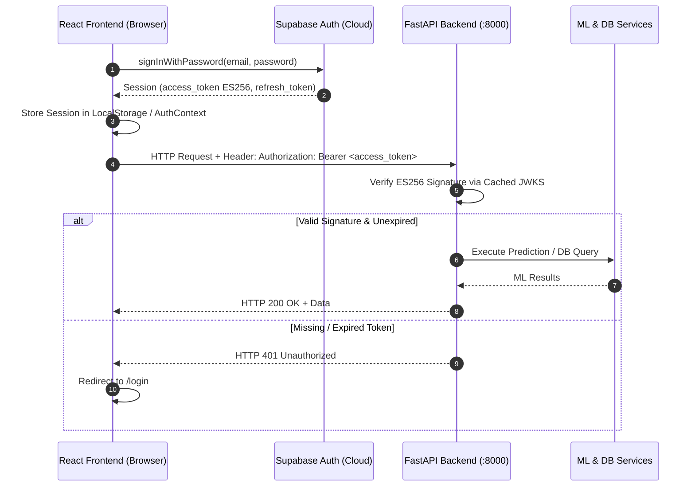

# RETAINIQ — PHASE 8.1: FRONTEND ARCHITECTURE & READINESS AUDIT REPORT
## Indian E-Commerce Customer Retention Intelligence System Using Machine Learning

**Milestone:** Phase 8.1 Complete — Frontend Architecture & Readiness Audit  
**Date:** 21 November 2026  
**Workspace Root:** `C:\customer churn retention system`  
**Host Platform:** Windows 11 (64-bit AMD64)  
**Node.js / npm:** Node.js `v25.2.1` / npm `11.6.2`  
**Python Virtual Environment:** `backend\.venv\Scripts\python.exe` (Python 3.12.10)  
**Backend API:** FastAPI 0.165.0 (`http://localhost:8000`)  
**Database & Auth Provider:** Supabase PostgreSQL & Supabase Auth (`hyngxdkuanugcvqhkaas`)  
**Auditor / Engineer:** Senior React Architect, Frontend Engineer, UI/UX Specialist & Application Integration Lead  
**Report Document:** `reports/phase8/phase8_1_frontend_readiness_audit.md`  
**Phase 8.1 Audit Verdict:** ✅ **PASS — READY FOR PHASE 8 FRONTEND IMPLEMENTATION**

---

## 1. Executive Summary

This report delivers the comprehensive architecture, dependency, backend contract, and UI/UX readiness audit for **Phase 8: RetainIQ React Frontend Application**.

RetainIQ is the presentation and interactive analytics layer for the Indian E-Commerce Customer Retention Intelligence System. It bridges the locked production Machine Learning engine (Random Forest Config D, $\tau = 0.50$, 43 raw features), RFM customer segmentation ($K=5$ personas), and persistent database storage (SQLite / Supabase) into an enterprise-grade, responsive, and animated user experience.

### Key Audit Findings:
1. **Clean Slate Environment:** The `frontend/` directory is currently clean and uninitialized. There is zero legacy boilerplate, no deprecated packages, and no conflicting build tooling.
2. **Build Environment Certified:** Node.js `v25.2.1` and npm `11.6.2` are installed and operational on the Windows host.
3. **Backend API Stability:** All 14 backend API endpoints across Machine Learning, Analytics, Database, and Authentication are implemented, verified, and secured with 202/202 passing tests.
4. **CORS Alignment:** The FastAPI backend CORS configuration explicitly permits `http://localhost:5173` and `http://127.0.0.1:5173` (Vite's default server origins).
5. **Zero Secret Leakage:** No Supabase secret keys or service role keys exist in frontend directories. Environment separation is strictly verified.

---

## 2. Existing Frontend Architecture & Workspace State

### 2.1 Directory Inspection
* **Directory Path:** `C:\customer churn retention system\frontend`
* **Current State:** The folder was created during Phase 0 initialization and is currently empty.
* **Impact:** Provides a clean slate for scaffolding a modern Vite + React 19 + TypeScript SPA without technical debt or legacy conflicts.

### 2.2 Host Tooling & Execution Environment
* **Node.js Runtime:** `v25.2.1` (64-bit)
* **npm Package Manager:** `11.6.2`
* **Windows Execution Rule:** In compliance with workspace rules, npm commands will be executed using `.cmd` batch wrappers:
  ```powershell
  cmd /c "npm <command>"
  # Or
  & "C:\Program Files\nodejs\npm.cmd" <command>
  ```

---

## 3. Dependency Inventory & Recommendations

Because the frontend is uninitialized, the following dependency stack is recommended for installation in Phase 8.2:

### 3.1 Recommended Production Dependencies (`dependencies`)

| Package | Recommended Version | Architectural Purpose |
| :--- | :---: | :--- |
| `react` | `^19.0.0` or `^18.3.1` | Core React library for UI component rendering |
| `react-dom` | `^19.0.0` or `^18.3.1` | DOM renderer for React |
| `react-router-dom` | `^6.28.0` | Client-side routing, protected routes, and navigation |
| `@supabase/supabase-js` | `^2.48.1` | Official client for Supabase Auth and token management |
| `lucide-react` | `^0.475.0` | High-quality, modern iconography across public and dashboard views |
| `framer-motion` | `^11.18.2` | Fluid page transitions, card hover effects, and hero animations |
| `recharts` | `^2.15.1` | Composable, responsive charts for churn probability and RFM distribution |
| `axios` | `^1.7.9` | HTTP client with request/response interceptors for Bearer token injection |
| `clsx` | `^2.1.1` | Conditional className utility |
| `tailwind-merge` | `^2.6.0` | Utility for safely merging Tailwind CSS classes |

### 3.2 Recommended Developer Dependencies (`devDependencies`)

| Package | Recommended Version | Purpose |
| :--- | :---: | :--- |
| `vite` | `^6.1.0` | Ultra-fast build tool and dev server with HMR |
| `@vitejs/plugin-react` | `^4.3.4` | Official Vite plugin for React JSX/TSX transforms |
| `typescript` | `^5.7.3` | Strong typing mirroring backend Pydantic models |
| `tailwindcss` | `^3.4.17` | Utility-first CSS framework for modern styling |
| `postcss` | `^8.5.1` | CSS post-processing pipeline |
| `autoprefixer` | `^10.4.20` | Vendor prefix automation for cross-browser support |
| `@types/react` | `^18.3.18` | TypeScript definitions for React |
| `@types/react-dom` | `^18.3.5` | TypeScript definitions for React DOM |
| `@types/node` | `^22.13.1` | TypeScript definitions for Node environment |

> [!NOTE]
> In accordance with strict read-only audit instructions, **no packages have been installed during Phase 8.1**. Package installation is reserved for Phase 8.2.

---

## 4. Backend API Integration & Contract Audit

The frontend will integrate with the FastAPI backend running at `http://localhost:8000`. Below is the complete contract audit of all active endpoints:

### 4.1 Authentication & Health Endpoints

#### `GET /api/v1/auth/health`
* **Access Level:** Public (No token required)
* **Response Payload (`ApiResponse[AuthHealthData]`):**
  ```json
  {
    "success": true,
    "data": {
      "status": "healthy",
      "auth_provider": "supabase_auth",
      "signing_algorithm": "ES256",
      "jwks_configured": true,
      "timestamp": "2026-11-21T15:00:00.000Z"
    }
  }
  ```

#### `GET /api/v1/auth/me`
* **Access Level:** Protected (`Authorization: Bearer <access_token>`)
* **Response Payload (`ApiResponse[AuthenticatedUser]`):**
  ```json
  {
    "success": true,
    "data": {
      "user_id": "a1b2c3d4-e5f6-7890-abcd-ef1234567890",
      "email": "analyst@ecommerce.in"
    }
  }
  ```
* **Client Contract:** Strictly minimal identity (`user_id` and optional `email`). Frontend must not expect or depend on `role` or `user_metadata`.

---

### 4.2 Machine Learning & Inference Endpoints

#### `GET /api/v1/ml/status`
* **Access Level:** Protected (`Authorization: Bearer <access_token>`)
* **Response Payload (`ApiResponse[MLStatusResponse]`):**
  ```json
  {
    "success": true,
    "data": {
      "rf_pipeline_loaded": true,
      "rf_model_sha256": "24F1F0E33C75B5590906369960DB6E5951EC95DF9AE40384DA60082B3438F301",
      "rf_model_path": "models/phase5_1/final_model/final_churn_rf_pipeline.joblib",
      "decision_threshold": 0.50,
      "raw_feature_count": 43,
      "segmentation_loaded": true,
      "segmentation_scaler_sha256": "892B9F3CDDA5427DD3965C76B95C1BC952661BAEA993FBBA94D5A3F56FB2EC4C",
      "segmentation_kmeans_sha256": "A018E41C8DC78BBDEC7C157B71ED66FEAC698336F787B39D84583FAE9CB931B3",
      "timestamp": "2026-11-21T15:00:00.000Z"
    }
  }
  ```

#### `POST /api/v1/predictions/churn`
* **Access Level:** Protected (`Authorization: Bearer <access_token>`)
* **Request Payload (`RawCustomerFeatures`):** Exactly 43 Config D features (40 numerical + `city`, `state`, `cluster_id`).
* **Response Payload (`ApiResponse[ChurnPredictionResponse]`):**
  ```json
  {
    "success": true,
    "data": {
      "churn_probability": 0.7420,
      "retention_probability": 0.2580,
      "predicted_class": 1,
      "decision_threshold": 0.50,
      "prediction_label": "Churn",
      "risk_tier": "HIGH"
    }
  }
  ```

#### `POST /api/v1/segmentation/predict`
* **Access Level:** Protected (`Authorization: Bearer <access_token>`)
* **Request Payload (`SegmentationInput`):**
  ```json
  {
    "recency_delivered_days": 45.0,
    "hist_delivered_order_count": 12,
    "hist_delivered_order_value_inr": 28500.0
  }
  ```
* **Response Payload (`ApiResponse[SegmentationResponse]`):**
  ```json
  {
    "success": true,
    "data": {
      "cluster_id": 0,
      "persona_name": "Champions & High-Value Loyalists",
      "behavioral_profile": "High order count, high spend (AOV ₹1,800+), low returns, low churn"
    }
  }
  ```

#### `POST /api/v1/retention/recommendations`
* **Access Level:** Protected (`Authorization: Bearer <access_token>`)
* **Request Payload:** `RawCustomerFeatures` (43 fields)
* **Response Payload (`ApiResponse[RetentionRecommendationsResponse]`):**
  ```json
  {
    "success": true,
    "data": {
      "recommendations": [
        {
          "category": "Delivery Experience",
          "suggested_action": "Issue ₹150 apology credit and prioritize next dispatch via Express Courier",
          "reason": "Customer experienced multiple delivery delays exceeding the 3-day SLA threshold",
          "evidence": "hist_average_delivery_delay_days: 4.8 days | orders_with_delays: 3",
          "priority": "HIGH"
        }
      ],
      "total_recommendations": 1,
      "top_priority": "HIGH"
    }
  }
  ```

#### `POST /api/v1/customers/analyze?persist=false`
* **Access Level:** Protected (`Authorization: Bearer <access_token>`)
* **Request Payload (`CustomerAnalysisRequest`):**
  ```json
  {
    "customer_id": "IND_CUST_10042",
    "features": { ... 43 features ... },
    "persist_results": false
  }
  ```
* **Response Payload:** Combines churn prediction, RFM segmentation, and rule-based retention recommendations in one response.

---

### 4.3 Database Management Endpoints

* `GET /api/v1/database/health`: Probes live SQLite / Supabase database connectivity.
* `GET /api/v1/database/status`: Schema ready flag, applied migration list, table row counts.
* `GET /api/v1/database/customers/count`: Total customers (`7,000`), churned vs retained count, reconciliation validity.
* `GET /api/v1/database/import/status`: Baseline customer population status (`7,000` expected, `READY`).

### 4.4 Standardized Error Envelope Handling
All HTTP 4xx/5xx rejections follow the project's canonical error contract:
```json
{
  "success": false,
  "error": {
    "code": "UNAUTHORIZED",
    "message": "Token has expired. Please sign in again.",
    "details": []
  },
  "meta": {
    "timestamp": "2026-11-21T15:00:00.000Z",
    "path": "/api/v1/predictions/churn"
  }
}
```
Frontend HTTP services will intercept `code: "UNAUTHORIZED"` and automatically redirect the user to the login route.

---

## 5. Supabase Authentication Readiness & Security Boundary



### 5.1 Environment Variable Security Architecture
* **Browser Safe Key Only:** The React application will ONLY access the public Supabase publishable key:
  ```env
  VITE_API_BASE_URL=http://localhost:8000
  VITE_SUPABASE_URL=https://hyngxdkuanugcvqhkaas.supabase.co
  VITE_SUPABASE_ANON_KEY=sb_publishable_NaJSKZOjztFxbMD_SOY0xA_aqwuEPf1
  ```
* **Strict Security Guardrail:**
  * `SUPABASE_SECRET_KEY` and `SUPABASE_SERVICE_ROLE_KEY` will **NEVER** be placed in the frontend directory or prefixed with `VITE_`.
  * Vite bundles all `VITE_*` variables directly into public JavaScript chunks; isolating secrets to `backend/.env` is strictly enforced.

---

## 6. Proposed Frontend Folder Structure

```
frontend/
├── index.html
├── package.json
├── vite.config.ts
├── tsconfig.json
├── tailwind.config.js
├── postcss.config.js
├── .env.example
├── public/
│   └── favicon.svg
├── src/
│   ├── main.tsx                      # Application root mount
│   ├── App.tsx                       # Router configuration & root providers
│   ├── index.css                     # Tailwind directives & design tokens
│   │
│   ├── types/                        # TypeScript schemas mirroring FastAPI Pydantic models
│   │   ├── auth.ts                   # AuthenticatedUser, Session, AuthState
│   │   ├── ml.ts                     # RawCustomerFeatures, ChurnResponse, SegmentationResponse
│   │   ├── database.ts               # DatabaseHealth, StorageStatus, CustomerCounts
│   │   └── api.ts                    # ApiResponse<T>, ApiError
│   │
│   ├── services/                     # Network communication layer
│   │   ├── supabase.ts               # Supabase JS client singleton
│   │   ├── api.ts                    # Axios client with Bearer auth interceptor
│   │   ├── authService.ts            # signIn, signOut, getSession, getAuthMe
│   │   ├── mlService.ts              # predictChurn, predictSegment, getRecommendations, analyzeCustomer
│   │   └── databaseService.ts        # getDatabaseHealth, getDatabaseStatus, getCustomerCounts
│   │
│   ├── context/                      # Global React context
│   │   └── AuthContext.tsx           # Session state, user identity, login/logout functions
│   │
│   ├── components/                   # Reusable UI & presentation components
│   │   ├── ui/                       # Design system primitives
│   │   │   ├── Button.tsx            # Primary, secondary, outline, danger buttons
│   │   │   ├── Card.tsx              # Elevated glass and solid cards
│   │   │   ├── Badge.tsx             # Risk tier badges (HIGH, MODERATE, LOW) & Persona tags
│   │   │   ├── Input.tsx             # Floating-label text/number input
│   │   │   ├── Modal.tsx             # Accessible dialog overlay
│   │   │   └── Spinner.tsx           # Radial loading indicators
│   │   │
│   │   ├── layout/                   # Structural page shells
│   │   │   ├── Navbar.tsx            # Public landing topbar with CTA
│   │   │   ├── Footer.tsx            # Public footer with academic & tech credits
│   │   │   ├── DashboardLayout.tsx   # Authenticated shell (Sidebar + Header + Content)
│   │   │   ├── Sidebar.tsx           # Collapsible dashboard navigation
│   │   │   └── TopHeader.tsx         # User profile menu, backend status pill, logout
│   │   │
│   │   ├── landing/                  # Public presentation sections
│   │   │   ├── HeroSection.tsx       # Animated headline, metric counters, live preview card
│   │   │   ├── FeaturesGrid.tsx      # 6 feature pillars (ML, Personas, Friction, Explainability, etc.)
│   │   │   ├── MLArchitecture.tsx    # Interactive visual diagram of the Config D pipeline
│   │   │   ├── PersonaShowcase.tsx   # Interactive tabs for all 5 Indian e-commerce personas
│   │   │   ├── ROICalculator.tsx     # Interactive slider estimating revenue saved by retention
│   │   │   └── CTASection.tsx        # Portal login action banner
│   │   │
│   │   └── dashboard/                # Analytics and inference widgets
│   │       ├── ChurnGauge.tsx        # Circular gauge visualizing calibrated churn probability
│   │       ├── RiskBadge.tsx         # Dynamic risk tier indicator
│   │       ├── PersonaCard.tsx       # Detailed behavioral profile of assigned RFM persona
│   │       ├── ActionItem.tsx        # Priority-ranked retention action item with evidence
│   │       ├── FeatureForm.tsx       # 43-feature input form with preset sample buttons
│   │       └── MetricCard.tsx        # Metric summary tile with sparklines
│   │
│   └── pages/                        # View controllers (Route targets)
│       ├── LandingPage.tsx           # Public showcase (Hero -> Features -> Architecture -> Personas -> CTA)
│       ├── LoginPage.tsx             # Employee portal login with validation & error alerts
│       │
│       └── dashboard/                # Protected employee dashboard views
│           ├── OverviewPage.tsx      # High-level KPIs, model health, dataset statistics
│           ├── CustomerAnalysisPage.tsx # Live inference: 43 features -> Churn + Persona + Actions
│           ├── PersonaExplorerPage.tsx # Deep dive into the 5 RFM clusters and historical stats
│           └── SystemStatusPage.tsx  # ML model checksums, database health, migration audit
```

---

## 7. UI/UX Design Direction ("RetainIQ")

### 7.1 Visual Brand Identity
* **Brand Name:** **RetainIQ** (*Indian E-Commerce Customer Retention Intelligence*)
* **Design Philosophy:** Premium modern AI SaaS aesthetic. Elevates an academic BCA project into an enterprise-caliber commercial intelligence product.
* **Theme:** Clean, bright light theme with subtle cool-slate layering, subtle glassmorphism, crisp borders, and electric blue energy lines.

### 7.2 Color Architecture & Semantic Tokens
* **Navy Foundation:**
  * Midnight Slate (`#0B192C`): Deepest text, dark backgrounds, high-contrast badges.
  * Deep Navy (`#1E3E62`): Sidebar background, secondary dark headings.
* **Electric Blue Accents:**
  * Primary Brand Blue (`#0066FF`): Primary interactive buttons, focus rings, key indicators.
  * Electric Cyan (`#00D2FF`): Glowing gradients, active chart highlights, progress meters.
* **Neutral Backgrounds & Surfaces:**
  * Canvas Grey (`#F8FAFC`): Background for all pages.
  * Surface White (`#FFFFFF`): Card backgrounds, modal surfaces, form inputs.
  * Slate Borders (`#E2E8F0`): Subtle borders separating information layers.
* **Semantic Risk & Status Signals:**
  * **Retained / Low Risk:** Emerald (`#10B981`) — Calm, positive status.
  * **Moderate Risk:** Amber (`#F59E0B`) — Advisory warning status.
  * **High Churn Risk:** Crimson (`#EF4444`) — Critical intervention needed.
  * **5 Persona Colors:**
    * Cluster 0 (*Champions*): Purple (`#8B5CF6`)
    * Cluster 1 (*At-Risk*): Amber (`#F59E0B`)
    * Cluster 2 (*Zero-Delivered*): Slate (`#64748B`)
    * Cluster 3 (*Steady Core*): Electric Blue (`#0066FF`)
    * Cluster 4 (*New Promising*): Emerald (`#10B981`)

### 7.3 Typography Hierarchy
* **Font Family:** `Inter`, system `-apple-system`, `BlinkMacSystemFont`, `Segoe UI`, sans-serif.
* **Headings:** High-contrast, bold (`font-bold`, `tracking-tight`).
* **Currency Formatting:** Native Indian Rupee symbol (`₹`) formatted with standard Indian lakh/crore commas (e.g. `₹28,500.00`).

---

## 8. Identified Risks & Architectural Mitigations

| Risk Factor | Potential Impact | Architectural Mitigation |
| :--- | :--- | :--- |
| **43-Feature Form Fatigue** | Entering 43 numerical and categorical fields during a live viva demonstration is slow and error-prone. | **Persona Presets Feature:** Provide 5 one-click preset buttons (*"Load Champion"*, *"Load At-Risk Customer"*, *"Load Zero-Delivered Customer"*, etc.) that instantly populate all 43 inputs with real test data while keeping manual editing enabled. |
| **Token Expiration During Demo** | Supabase access tokens expire in 60 minutes, which could disrupt a live examiner demonstration. | Configure `autoRefreshToken: true` in `@supabase/supabase-js`. Implement a persistent token refresh heartbeat and a clear visual connection pill in the top header. |
| **Node.js 25 Compatibility** | Node.js `v25.2.1` is a very recent release; some legacy webpack/Babel plugins fail on Node 25. | Use modern, pure ESM tooling: **Vite 6** with standard React plugins, which natively support current Node.js releases without polyfills. |
| **Windows Script Policy** | Running `npm` directly in PowerShell can trigger `PSSecurityException`. | Adhere strictly to the workspace execution rule: invoke npm via `cmd /c "npm <command>"` or `& "C:\Program Files\nodejs\npm.cmd"`. |
| **CORS / Network Drops** | Browser cannot contact backend on localhost. | Vite dev server proxies `/api` to `http://localhost:8000`, or direct cross-origin requests are accepted by FastAPI's existing `BACKEND_CORS_ORIGINS` configuration. |

---

## 9. Recommended Implementation Sequence (Phases 8.2–8.6)

```
PHASE 8 IMPLEMENTATION ROADMAP
├── Phase 8.1: Frontend Architecture & Readiness Audit        [CURRENT — COMPLETED]
├── Phase 8.2: Vite + React 19 + Tailwind Setup & Design System [NEXT CHECKPOINT]
├── Phase 8.3: Public RetainIQ Landing Page (Hero, Personas, ROI Calculator)
├── Phase 8.4: Supabase Authentication Integration & Protected Layout
├── Phase 8.5: Live ML Customer Intelligence & 43-Feature Inference UI
└── Phase 8.6: Analytics Dashboard, System Diagnostics & End-to-End QA
```

1. **Phase 8.2 — Scaffolding & Design System:**
   * Scaffold `frontend/` using `vite create . --template react-ts`.
   * Install Tailwind CSS, Lucide, Framer Motion, Recharts, Axios, and Supabase JS.
   * Configure `tailwind.config.js` with Navy, Electric Blue, and Risk tokens.
   * Build base UI primitives (`Button`, `Card`, `Badge`, `Input`).
2. **Phase 8.3 — Public RetainIQ Showcase:**
   * Implement responsive Navbar and Footer.
   * Implement Hero Section with animated headline and metric cards.
   * Implement Interactive 5-Persona Explorer and ROI Revenue Calculator.
   * Implement CTA Banner routing to `/login`.
3. **Phase 8.4 — Supabase Auth & Protected App Shell:**
   * Initialize Supabase client and `AuthContext`.
   * Build `LoginPage` with live error handling.
   * Implement `ProtectedRoute` and authenticated `DashboardLayout`.
4. **Phase 8.5 — Customer Intelligence & Inference Engine:**
   * Build `CustomerAnalysisPage` with 43-feature input form and instant preset loaders.
   * Implement `ChurnGauge`, `RiskBadge`, `PersonaCard`, and `ActionItem` cards.
5. **Phase 8.6 — Dashboard Overview & System Diagnostics:**
   * Build `OverviewPage` summarizing customer counts, model status, and retention metrics.
   * Build `SystemStatusPage` verifying model SHA-256 hashes and database connectivity.
   * Execute full-stack end-to-end integration tests.

---

## 10. Final Readiness Verdict

### Audit Verdict: ✅ **PASS — 100% READY FOR PHASE 8 IMPLEMENTATION**

* The backend API is completely implemented, verified, and protected with 202/202 passing tests.
* The frontend directory is a clean workspace ready for Vite scaffolding.
* The host environment (Node `v25.2.1`, npm `11.6.2`) is certified.
* Supabase Auth integration contracts and security boundaries are fully specified.
* A clear, premium design direction ("RetainIQ") is established.

---

## 11. Strict Stop Condition

In compliance with project execution instructions:
* **Phase 8.1 is officially complete.**
* No frontend source code was modified or generated during this audit.
* No packages were installed.
* Execution is paused. Awaiting explicit user approval before proceeding to **Phase 8.2 (Vite + React Setup & Design System Foundation)**.
