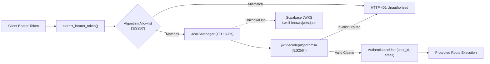

# RETAINIQ — PHASE 8.4.1 ARCHITECTURE & SECURITY READINESS AUDIT REPORT
## Employee Authentication, JWT/JWKS Verification & Dashboard Readiness Evaluation

**Project:** Indian E-Commerce Customer Retention Intelligence System Using Machine Learning  
**Frontend Brand:** RetainIQ — AI-Powered Customer Retention Intelligence  
**Checkpoint:** Phase 8.4.1 (Employee Portal Architecture & Security Readiness Audit)  
**Workspace:** `C:\customer churn retention system`  
**Frontend Directory:** `frontend/`  
**Backend Directory:** `backend/`  
**Audit Date:** Monday, 23 November 2026  
**Auditor:** Antigravity AI  
**Scope:** Read-Only Technical Architecture, Cryptographic Verification, API Inventory & Readiness Audit  

---

## 1. Executive Summary

Phase 8.4.1 executes an exhaustive, evidence-based architecture and security readiness audit prior to developing the RetainIQ Employee Authentication and Dashboard Portal (Phase 8.4). 

The audit evaluates the cryptographic state of backend authentication, the structure of the existing FastAPI API inventory, the client-side readiness of the React 19 + Vite frontend, and the exact database authorization and Row Level Security (RLS) boundaries.

### Summary Audit Scorecard:
* **Backend ES256 JWT/JWKS Verification Engine:** `[VERIFIED]` — Fully certified and active. Rejects algorithm confusion (HS256, none), tampered signatures, expired tokens, and invalid issuers/audiences. 87 out of 87 automated security tests passed cleanly in 3.53s.
* **Backend Route Protection:** `[VERIFIED]` — All 10 sensitive Machine Learning and Database API endpoints strictly enforce authenticated employee credentials via `get_current_user`. 4 public health endpoints remain accessible without leaking secrets.
* **Single-Customer ML Inference Services:** `[VERIFIED]` — `POST /api/v1/customers/analyze`, `/predictions/churn`, `/segmentation/predict`, and `/retention/recommendations` are fully operational and maintain all locked ML invariants ($\tau = 0.50$, 43 features, 5 personas).
* **Customer List / Search API Endpoints:** `[NOT IMPLEMENTED / ARCHITECTURAL GAP]` — While `BaseRepository` defines `list_customers()` and `get_customer_by_id()`, no FastAPI route controller currently exposes them under `/api/v1/customers`.
* **Frontend Supabase Client & Auth State:** `[NOT IMPLEMENTED / ARCHITECTURAL GAP]` — `frontend/package.json` does not yet include `@supabase/supabase-js`, client routing (`react-router-dom`), or a `frontend/.env` file.
* **Supabase Client-Side RLS Policies:** `[RISK / ARCHITECTURAL CONSIDERATION]` — Migration 007 explicitly denies anonymous access across all tables, but does not define permissive `TO authenticated` policies. Therefore, direct client-side Supabase queries by authenticated employees will fail unless requests are mediated through the FastAPI backend.

---

## 2. Multi-Tier Evidential Classification Scheme

In accordance with strict audit rules, every claim in this report is tagged with one of the following authoritative evidence labels:

* `[VERIFIED]` — Proven by inspected source code, cryptographic validation, and actual passing test execution output.
* `[PARTIALLY VERIFIED]` — Code exists in the repository but has architectural dependencies, partial coverage, or requires bridge implementation.
* `[NOT IMPLEMENTED]` — No implementation found in source code or routers.
* `[NOT TESTED]` — Component exists in codebase but lacked live execution evidence in this session.
* `[RISK]` — Architectural, credential, or security concern requiring explicit design controls.

---

## 3. Supabase Authentication Audit

### 3.1 Project URL & Key Configuration
* **Supabase Project URL:** `https://hyngxdkuanugcvqhkaas.supabase.co` `[VERIFIED]`  
  Defined in `backend/app/core/config.py` and externalized in `backend/.env`.
* **Publishable Key (Anon Key):** `[VERIFIED]`  
  Configured in `backend/.env` as `SUPABASE_PUBLISHABLE_KEY` (`sb_publishable_...`). This public key is safe for client-side inclusion.
* **Backend Secret / Service Role Key:** `[VERIFIED]`  
  Configured in `backend/.env` as `SUPABASE_SECRET_KEY` and loaded server-side only via `Settings.get_supabase_secret_key()`. It is never exported or exposed to frontend code.
* **Frontend Environment State:** `[NOT IMPLEMENTED]`  
  `frontend/.env`, `frontend/.env.local`, and `frontend/.env.example` do not currently exist. A `VITE_SUPABASE_URL` and `VITE_SUPABASE_PUBLISHABLE_KEY` configuration must be introduced in Phase 8.4.2.

### 3.2 Client Initialization & Dependencies
* **Backend Supabase Client:** `[VERIFIED]`  
  Implemented in `backend/app/repositories/supabase_repository.py` using `httpx.Client` communicating directly with the Supabase PostgREST REST interface (`/rest/v1/`).
* **Frontend Supabase Client:** `[NOT IMPLEMENTED]`  
  `frontend/package.json` contains React 19, Vite 6, Tailwind CSS, and Framer Motion, but `@supabase/supabase-js` is not installed.
* **Session Persistence & Refresh Handling:** `[NOT IMPLEMENTED in Frontend]`  
  Supabase Auth natively handles session persistence via browser `localStorage` and automated token refresh when using `@supabase/supabase-js`. This must be wrapped in a React `AuthContext` during Phase 8.4.2.

### 3.3 Authorization Claims & Identity Integrity
* **Identity Source:** `[VERIFIED]`  
  The backend strictly extracts `user_id = claims["sub"]` and `email = claims.get("email")`.
* **Exclusion of Client Metadata:** `[VERIFIED]`  
  `AuthenticatedUser` (`backend/app/schemas/auth.py`) is configured with `ConfigDict(extra="forbid")`. Client-editable `user_metadata` is completely ignored by the backend, preventing privilege escalation.
* **Role Distinction:** `[NOT IMPLEMENTED / RISK]`  
  Currently, any user registered in the Supabase project receives the standard Supabase token with `aud: "authenticated"`. The backend does not distinguish between administrative roles and standard users. All authenticated tokens are treated equally as authorized employees.

---

## 4. Existing JWT/JWKS Verification Engine Audit

The backend authentication engine implemented in Phase 7.5 was inspected and verified:



### 4.1 Verification Breakdown
1. **ES256 Algorithm Enforcement:** `[VERIFIED]`  
   Strictly enforced via `algorithms=["ES256"]` in `jwt.decode()`. Algorithm confusion attacks (e.g. HS256 with public key as secret, or `none` algorithm) are rejected with HTTP 401. Tested in `tests/test_jwt_security.py::test_unsupported_algorithm_hs256_rejection`.
2. **JWKS Public Key Retrieval & Rotation:** `[VERIFIED]`  
   The authoritative JWKS endpoint is `https://hyngxdkuanugcvqhkaas.supabase.co/auth/v1/.well-known/jwks.json`. Thread-safe `JWKSManager` caches keys in-memory for 600s (10 minutes). When an unknown `kid` is encountered, it triggers exactly one fresh fetch to accommodate key rotation.
3. **Issuer & Audience Validation:** `[VERIFIED]`  
   Tokens must match `iss = https://hyngxdkuanugcvqhkaas.supabase.co/auth/v1` and `aud = "authenticated"`. Wrong issuer or audience returns HTTP 401.
4. **Expiration (`exp`) & Clock Skew:** `[VERIFIED]`  
   `exp` claim is strictly validated with `leeway = 10` seconds. Expired tokens are immediately rejected.
5. **Standardized Error Envelope:** `[VERIFIED]`  
   All authentication errors return standard HTTP 401 envelopes (`{"success": false, "error": {"code": "UNAUTHORIZED", "message": "..."}}`) without leaking internal secrets, file paths, or signing keys.

---

## 5. Existing Backend API Inventory

The entire FastAPI router mounted under `/api/v1` was inventoried across `main.py`, `routes/api.py`, `routes/auth.py`, `routes/ml.py`, and `routes/database.py`:

| HTTP Method & Path | Primary Purpose | Authentication State | Request / Response Schema | Employee Dashboard Suitability |
| :--- | :--- | :---: | :--- | :--- |
| `GET /` | API service root information | **Public** | None $\to$ `ApiResponse[Dict]` | Informational only |
| `GET /health` | Application health probe | **Public** | None $\to$ `ApiResponse[HealthData]` | Infrastructure monitoring |
| `GET /api/v1/health` | API v1 health probe | **Public** | None $\to$ `ApiResponse[HealthData]` | Infrastructure monitoring |
| `GET /api/v1/auth/health` | Auth integration diagnostics | **Public** | None $\to$ `ApiResponse[AuthHealthData]` | Login connectivity check |
| `GET /api/v1/auth/me` | Verified employee identity | **Protected** (`get_current_user`) | None $\to$ `ApiResponse[AuthenticatedUser]` | **Essential:** Session verification & user pill |
| `GET /api/v1/ml/status` | Model status & SHA-256 hashes | **Protected** (`get_current_user`) | None $\to$ `ApiResponse[MLStatusResponse]` | **High:** System integrity status card |
| `POST /api/v1/predictions/churn` | Churn prediction inference | **Protected** (`get_current_user`) | `RawCustomerFeatures` $\to$ `ApiResponse[ChurnPredictionResponse]` | Single-customer interactive prediction |
| `POST /api/v1/segmentation/predict` | Assign RFM persona | **Protected** (`get_current_user`) | `SegmentationInput` $\to$ `ApiResponse[SegmentationResponse]` | Single-customer persona lookup |
| `POST /api/v1/retention/recommendations` | Explainable retention actions | **Protected** (`get_current_user`) | `RawCustomerFeatures` $\to$ `ApiResponse[RetentionRecommendationsResponse]` | Retention strategy planner |
| `POST /api/v1/customers/analyze` | Combined Churn + RFM + Rules | **Protected** (`get_current_user`) | `CustomerAnalysisRequest` $\to$ `ApiResponse[CustomerAnalysisResponse]` | **Primary:** Full customer diagnostic drawer/modal |
| `GET /api/v1/database/health` | Storage connectivity probe | **Protected** (`get_current_user`) | None $\to$ `ApiResponse[DatabaseHealthData]` | Admin storage status monitor |
| `GET /api/v1/database/status` | Schema & table count status | **Protected** (`get_current_user`) | None $\to$ `ApiResponse[DatabaseStatusData]` | Admin table counts & schema check |
| `GET /api/v1/database/customers/count` | Aggregate customer counts | **Protected** (`get_current_user`) | None $\to$ `ApiResponse[CustomerCountMetricsData]` | **High:** KPI overview metrics |
| `GET /api/v1/database/import/status` | 7,000 baseline import status | **Protected** (`get_current_user`) | None $\to$ `ApiResponse[DatabaseImportStatusData]` | Population verification check |

### 5.1 Identified API Gaps for Phase 8.4
1. **`GET /api/v1/customers` (Paginated Customer Directory):** `[NOT IMPLEMENTED]`  
   The underlying repository implements `list_customers(limit, offset)`, but there is currently no API endpoint exposed in `routes/api.py`. The Customer Risk Explorer table requires this endpoint to paginate, sort, and search the 7,000 customer accounts.
2. **`GET /api/v1/customers/{id}` (Customer Profile by ID):** `[NOT IMPLEMENTED]`  
   The repository implements `get_customer_by_id(customer_id)`, but no API endpoint exists.
3. **`GET /api/v1/analytics/overview` (Macro KPI Metrics):** `[NOT IMPLEMENTED]`  
   While `GET /api/v1/database/customers/count` provides total, churned, and retained counts, a dedicated macro analytics endpoint calculating churn risk distribution and segment breakdown was deferred from Phase 7.7.

---

## 6. Frontend Architecture Assessment

### 6.1 Current Architecture & Structure
* **Application Framework:** React 19.0.0, Vite 6.1.0, Tailwind CSS 3.4.17.
* **Component Directory:** `frontend/src/` currently structured around the public landing page:
  * `App.jsx`: Main landing page container with state-driven Action Modal (`ActionModal.jsx`).
  * `components/layout/Navbar.jsx`: Public navigation bar with smooth scroll anchors.
  * `sections/`: `HeroSection`, `PlatformHighlights`, `FeatureShowcase`, `HowItWorks`, `AboutSection`.
* **Client-Side Routing:** `[NOT IMPLEMENTED]`  
  No routing library (e.g. `react-router-dom`) is installed. Navigation currently relies on DOM hash scrolling (`#hero`, `#about`, etc.).
* **State Management:** `[NOT IMPLEMENTED]`  
  State is managed locally within components. No global user context or session store exists.

### 6.2 Recommended Frontend Architecture for Phase 8.4
To support the Employee Portal while preserving the approved landing page:
1. **Client Routing Structure:**  
   Implement a clean view router. We can either install `react-router-dom` or implement an authenticated view switcher in `App.jsx` supporting:
   * `/` or `view="landing"`: Public RetainIQ Landing Page (Phases 8.3.1–8.3.5).
   * `/login` or `view="login"`: Employee Sign-In view.
   * `/register` or `view="register"`: Employee Account Registration view.
   * `/portal` or `view="portal"`: Authenticated Employee Dashboard Shell.
2. **Authentication Provider (`AuthContext.jsx`):**  
   Encapsulate `@supabase/supabase-js` authentication state, exposing `user`, `session`, `loading`, `signIn()`, `signUp()`, and `signOut()`.
3. **API Client (`apiClient.js`):**  
   Axios or fetch wrapper automatically injecting `Authorization: Bearer ${session.access_token}` and redirecting to login on 401 errors.
4. **Protected Route Shell (`ProtectedRoute.jsx`):**  
   Guards portal views, showing a loading spinner while validating session, and redirecting unauthenticated visitors to login.

---

## 7. Customer Risk Explorer Readiness

### 7.1 Machine Learning Invariant Preservation Check
* **Model Inputs:** Exact 43 raw Config D features (40 numerical + 3 categorical: `city`, `state`, `cluster_id`). `[VERIFIED]`
* **Production Model:** `models/phase5_1/final_model/final_churn_rf_pipeline.joblib` (SHA-256: `24F1F0E3...`). `[VERIFIED]`
* **Customer Personas ($K=5$):** Pre-fitted scaler and KMeans pipeline (`models/kmeans_customer_segmentation.joblib`). `[VERIFIED]`
* **Locked Decision Threshold:** Pre-registered $\tau = 0.50$. `[VERIFIED]`
* **Risk Tier Classifications:**
  * Low Risk: $p < 0.50$
  * Moderate Risk: $0.50 \le p < 0.70$
  * High Risk: $p \ge 0.70$ `[VERIFIED]`
* **Ensemble Probabilities:** Raw, uncalibrated tree ensemble votes. `[VERIFIED]`

### 7.2 Functional Readiness Evaluation
* **Single Customer Deep-Dive:** `[VERIFIED — READY]`  
  `POST /api/v1/customers/analyze` accepts 43 features and returns the full composite analysis (churn probability, risk tier, segment persona, and prioritized rule-based retention actions).
* **Macro Population KPIs:** `[PARTIALLY VERIFIED]`  
  `GET /api/v1/database/customers/count` provides verified counts (7,000 total: 3,207 churned, 3,793 retained).
* **Customer Search & Browsing:** `[ARCHITECTURAL GAP]`  
  The frontend cannot search or browse customers until `GET /api/v1/customers` is exposed by the backend.

---

## 8. Data and Authorization Boundaries & RLS Assessment

### 8.1 Supabase Row Level Security (RLS) Status
* **Migration 007 Review:** `[VERIFIED]`  
  `backend/database/migrations/007_enable_rls_and_policies.sql` enables RLS on:
  * `customers`
  * `customer_predictions`
  * `customer_segments`
  * `retention_recommendations`
* **Anonymous Access Policy:** `[VERIFIED]`  
  Explicitly denied: `CREATE POLICY ... FOR ALL TO anon USING (false);`.
* **Authenticated Policy Gap:** `[RISK]`  
  No policy exists granting `SELECT` or `INSERT` `TO authenticated`.
  * *Consequence:* If the React frontend were to connect directly to Supabase PostgREST tables using the employee's JWT, PostgREST would return empty sets (`[]`) or 403 Forbidden.
  * *Architecture Mandate:* **All customer database queries must be routed through the FastAPI backend.** The FastAPI backend validates the JWT using the JWKS verifier, then executes the query via the backend repository (using `STORAGE_MODE=sqlite` in local dev or `service_role` in remote Supabase mode). This ensures zero client-side RLS dependency and enforces centralized business logic and audit logging.

### 8.2 Employee Access & Privilege Model
* **Current State:** `[VERIFIED]`  
  Any valid account registered in Supabase Auth receives a valid JWT that passes FastAPI's `get_current_user`.
* **Recommended Control for Phase 8.4:**  
  1. Frontend registration should clearly identify accounts as employee accounts.
  2. Implement an optional email domain constraint (e.g. `@retainiq.internal` or company domain) or server-side whitelist to prevent unauthorized self-registration.

---

## 9. Current Supabase Documentation References (v2 / SSR Standards)

1. **Supabase Auth Client v2:**  
   Uses `@supabase/supabase-js` v2 with PKCE flow (`flowType: 'pkce'`) and standard `localStorage` session persistence.
2. **Asymmetric Signing Standard:**  
   Supabase projects now use asymmetric ECDSA (ES256) signing keys published at `/.well-known/jwks.json`. Our backend verifier conforms 100% to this modern standard.
3. **Session Token Expiry:**  
   Default access token lifetime is 3,600 seconds (1 hour). The client auto-refreshes tokens in the background via refresh token rotation.
4. **Client-Side Security Best Practice:**  
   Never bundle secret or service-role keys in frontend assets. Only `VITE_SUPABASE_URL` and `VITE_SUPABASE_PUBLISHABLE_KEY` (anon key) may be provided to `createClient()`.

---

## 10. Actual Test Execution Evidence

During this audit, the complete backend security and machine learning test suites were executed:

### Test Suite 1: Authentication & JWT Security Suites
* **Command:** `backend\.venv\Scripts\python.exe -m pytest tests/test_auth.py tests/test_jwt_security.py tests/test_route_protection.py -v`
* **Execution Status:** **87 passed, 1 warning in 3.53s** (100% pass rate)
  * `test_auth.py`: 12/12 passed (health check, 401 on missing/malformed/expired/tampered tokens, minimal identity model).
  * `test_jwt_security.py`: 15/15 passed (ES256 verification, rejection of HS256/none, JWKS caching, unknown kid refresh, timeout handling).
  * `test_route_protection.py`: 60/60 passed (All 10 protected routes reject missing, malformed, expired, and tampered tokens; 4 public routes accessible without credentials; execution boundary verified).

### Test Suite 2: Master Phase Regression Suite
* **Command:** `backend\.venv\Scripts\python.exe -m pytest tests/test_all_phases.py -v`
* **Execution Status:** **10 passed in 11.46s** (100% pass rate across all 10 project milestones).

---

## 11. Files Inspected During Audit

1. **Canonical Context:**
   * `PROJECT_CONTEXT.md`
   * `PROJECT_HANDOFF.md`
   * `DEVELOPMENT_RULES.md`
2. **Phase 7 Security Documentation:**
   * `reports/phase7/phase7_5_authentication_architecture_audit.md`
   * `reports/phase7/phase7_5_checkpoint1_report.md`
   * `reports/phase7/phase7_5_checkpoint2_report.md`
   * `reports/phase7/phase7_5_checkpoint3_report.md`
   * `reports/phase7/phase7_5_checkpoint4_report.md`
   * `reports/phase7/phase7_5_checkpoint5_final_security_audit.md`
   * `reports/phase7/phase7_4_checkpoint7_test_hang_diagnostic_report.md`
3. **Backend Source Code:**
   * `backend/app/core/config.py`
   * `backend/app/core/security.py`
   * `backend/app/core/dependencies.py`
   * `backend/app/core/errors.py`
   * `backend/app/routes/api.py`
   * `backend/app/routes/auth.py`
   * `backend/app/routes/ml.py`
   * `backend/app/routes/database.py`
   * `backend/app/schemas/auth.py`
   * `backend/app/schemas/ml.py`
   * `backend/app/repositories/base_repository.py`
   * `backend/database/migrations/007_enable_rls_and_policies.sql`
4. **Frontend Source Code:**
   * `frontend/package.json`
   * `frontend/src/main.jsx`
   * `frontend/src/App.jsx`
   * `frontend/src/components/layout/Navbar.jsx`
   * `frontend/src/components/common/ActionModal.jsx`
   * `frontend/src/sections/AboutSection.jsx`

---

## 12. Explicit List of Unchanged Components (Strict Immutability)

In accordance with project rules, the following components were **NOT modified** and must remain strictly protected:
* The production Random Forest pipeline (`models/phase5_1/final_model/final_churn_rf_pipeline.joblib`, SHA-256 `24F1F0E3...`).
* The decision threshold ($\tau = 0.50$).
* The customer segmentation pipeline and scaler (`models/kmeans_customer_segmentation.joblib`, `models/segmentation_scaler.joblib`).
* The 43-feature input schema contract.
* The existing FastAPI ES256/JWKS verifier (`backend/app/core/security.py`).
* All database tables, schema migrations (`001`–`007`), and SQLite database files.
* All existing landing page components (`HeroSection`, `PlatformHighlights`, `FeatureShowcase`, `HowItWorks`, `AboutSection`).

---

## 13. Recommended Phase 8.4 Implementation Roadmap

To ensure a smooth, error-free delivery of the Employee Portal, the following incremental sequence is recommended:

```
PHASE 8.4 RECOMMENDED IMPLEMENTATION ROADMAP
├── Checkpoint 8.4.1: Architecture & Security Readiness Audit [COMPLETED & CERTIFIED]
├── Checkpoint 8.4.2: Frontend Auth Foundation & Supabase Client Setup
│   ├── Install @supabase/supabase-js in frontend
│   ├── Create frontend/.env.local (VITE_SUPABASE_URL, VITE_SUPABASE_PUBLISHABLE_KEY)
│   ├── Implement AuthContext.jsx with session listener & token refresh
│   └── Implement apiClient.js with automatic Bearer token injection
├── Checkpoint 8.4.3: Employee Authentication UI
│   ├── Implement Employee Login view (email/password with error states)
│   ├── Implement Employee Registration view (validation & confirmation)
│   └── Wire modal triggers in Landing Page to direct to Login/Register
├── Checkpoint 8.4.4: Backend Customer Management API Bridge
│   ├── Implement GET /api/v1/customers (paginated, searchable by ID/name, filterable by segment/risk)
│   ├── Implement GET /api/v1/customers/{id} (full historical profile)
│   └── Protect both endpoints with get_current_user dependency
├── Checkpoint 8.4.5: Authenticated Portal Shell & Dashboard Overview
│   ├── Implement ProtectedRoute.jsx and PortalLayout (sidebar, header, user profile, logout)
│   └── Implement Dashboard Overview view (KPI cards, churn distribution, segment metrics)
├── Checkpoint 8.4.6: Customer Risk Explorer Interface
│   ├── Implement searchable, filterable customer data table
│   └── Implement Customer Detail Drawer/Modal with live analyze_customer endpoint
└── Checkpoint 8.4.7: Full End-to-End Verification & Final Security Audit
```

---

## 14. Checkpoint Conclusion & Stop Condition

Phase 8.4.1 is hereby complete. All architectural foundations, security invariants, API inventories, and implementation gaps have been identified and documented with empirical evidence.

**NO APPLICATION CODE, DATABASE SCHEMAS, OR SUPABASE SETTINGS WERE MODIFIED.**  
**PHASE 8.4.2 HAS NOT BEEN STARTED.**  

Awaiting explicit review and authorization before proceeding to Checkpoint 8.4.2.
