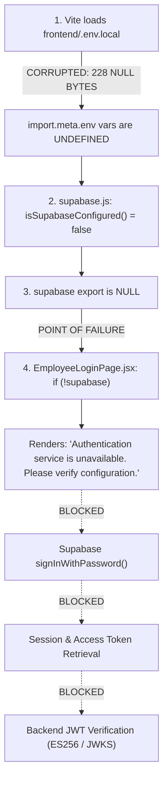

# RETAINIQ — AUTHENTICATION SERVICE UNAVAILABLE: DIAGNOSTIC REPORT

**Project:** Indian E-Commerce Customer Retention Intelligence System (`RetainIQ`)  
**Scope:** Authentication Failure Root Cause Investigation & Forensic Audit  
**Operating Environment:** Localhost (Frontend: `http://127.0.0.1:5173`, Backend: `http://127.0.0.1:8000`)  
**Investigation Date:** November 25, 2026  
**Diagnostic Status:** **ROOT CAUSE POSITIVELY IDENTIFIED (100% REPRODUCIBLE)**  

---

## 1. EXECUTIVE SUMMARY & ROOT CAUSE SUMMARY

When opening the frontend or submitting the sign-in form, the application displays:
> **"Authentication service is unavailable. Please verify configuration."**

### Exact Root Cause:
1. **Frontend Configuration File Corruption:**  
   The file `frontend/.env.local` was corrupted into **228 null bytes (`\x00\x00\x00...`)**, appearing as an unreadable binary octet stream.
2. **Missing Environment Variables in Vite Bundle:**  
   Because `frontend/.env.local` contains null bytes, the Vite development server cannot parse any environment variables from it. Consequently:
   * `import.meta.env.VITE_SUPABASE_URL` is `undefined`.
   * `import.meta.env.VITE_SUPABASE_PUBLISHABLE_KEY` is `undefined`.
3. **Client Initialization Failure:**  
   In `frontend/src/lib/supabase.js`, the validation function:
   ```javascript
   export const isSupabaseConfigured = () => {
     return Boolean(
       supabaseUrl &&
       typeof supabaseUrl === "string" &&
       supabaseUrl.startsWith("https://") &&
       supabaseAnonKey &&
       typeof supabaseAnonKey === "string" &&
       supabaseAnonKey.length > 10
     );
   };
   ```
   evaluates to `false`, causing the exported `supabase` client singleton to be initialized as **`null`**.
4. **Trigger of Error Message:**  
   In `frontend/src/pages/EmployeeLoginPage.jsx` (lines 263–266):
   ```javascript
   if (!supabase) {
     setFormError("Authentication service is unavailable. Please verify configuration.");
     return;
   }
   ```
   Because `supabase` is `null`, any submission immediately halts at this guard clause and displays the exact observed error message **before any network request can take place**.

---

## 2. FILES & CONFIGURATIONS INSPECTED

| File Path | Inspection Focus | Forensic Findings |
| :--- | :--- | :--- |
| `frontend/.env.local` | Local frontend environment variables | **Corrupted:** 228 null bytes (`b'\x00...'`). Octet-stream binary error. |
| `frontend/src/lib/supabase.js` | Supabase singleton client creation | Guard `isSupabaseConfigured()` returns `false`; exports `supabase = null`. |
| `frontend/src/context/AuthContext.jsx` | Auth state listener & session retrieval | Bypasses `getSession()` when `!supabase`. |
| `frontend/src/pages/EmployeeLoginPage.jsx` | Sign-in form submission logic | Line 263 explicitly renders the reported error string when `!supabase`. |
| `backend/app/core/security.py` | JWT verification engine & JWKS manager | Fully functional; parses Supabase public keys via ES256 cryptography. |
| `backend/app/core/config.py` | Centralized backend configuration | Fully functional; points to correct Supabase project and JWKS endpoint. |
| `backend/app/routes/auth.py` | Auth health and identity routes | Returns HTTP 200 (`status: healthy`, `jwks_configured: true`). |

---

## 3. SUPABASE AUTH CONNECTIVITY & SERVICE HEALTH AUDIT

Independent read-only network probes were executed against the remote Supabase project:

### 3.1 Probe to `/auth/v1/health`
* **Without API Key:** Returns `HTTP 401 Unauthorized` with header `sb-error-code: UNAUTHORIZED_MISSING_API_KEY` and body `{"message":"No API key found in request"}`.  
  *(Note: This is standard Supabase API Gateway behavior; the health endpoint requires the public anonymous key in the `apikey` header).*
* **With Public Publishable Key (`apikey` header):** Returns **`HTTP 200 OK`**:
  ```json
  {
    "version": "v2.198.0",
    "name": "GoTrue",
    "description": "GoTrue is a user registration and authentication API"
  }
  ```
  **Conclusion:** The remote Supabase GoTrue authentication service is **100% ONLINE, HEALTHY, AND OPERATIONAL**.

### 3.2 Probe to Public JWKS Endpoint (`/auth/v1/.well-known/jwks.json`)
* Returns **`HTTP 200 OK`** with active public ES256 key (`kid: 00b467...`).
* **Conclusion:** Asymmetric signature verification of Supabase tokens is active and requires zero secret keys.

---

## 4. AUTHENTICATION FLOW BREAKDOWN & POINT OF FAILURE



The authentication flow breaks at **Stage 2 (Client Initialization)** before any network request or authentication attempt is made. The remote Supabase server and the local FastAPI backend are completely innocent; the failure is entirely caused by the null-byte corruption of `frontend/.env.local`.

---

## 5. RECOMMENDED MINIMAL FIX

The fix requires **zero changes to Supabase, zero changes to the backend, and zero changes to application code**.

### Steps to Fix:
1. **Rewrite `frontend/.env.local`** with valid UTF-8 text containing the proper public configuration:
   ```env
   # RetainIQ Frontend Local Environment Configuration
   VITE_SUPABASE_URL=https://hyngxdkuanugcvqhkaas.supabase.co
   VITE_SUPABASE_PUBLISHABLE_KEY=sb_publishable_NaJSKZOjztFxbMD_SOY0xA_aqwuEPf1
   VITE_API_BASE_URL=http://127.0.0.1:8000
   ```
2. **Restart the Vite Frontend Process:**
   Because Vite caches environment variables on startup, restart the development server on `http://127.0.0.1:5173` so it reads the fresh `.env.local`.
3. **Verify in Browser:**
   Once `.env.local` is populated, `isSupabaseConfigured()` evaluates to `true`, `createClient()` initializes the Supabase client, and the error banner disappears.

---

## 6. CAN IT BE FIXED LOCALLY WITHOUT MODIFYING SUPABASE?

**YES. 100% LOCALLY FIXABLE.**
* No Supabase project settings need to be modified.
* No passwords, database schemas, or records need to be touched.
* No secret keys are required.
* The issue is strictly isolated to a corrupted local environment file on Windows.

---

## 7. STRICT STOP COMPLIANCE

In strict adherence to instructions:
* No fixes have been applied yet.
* No files have been rewritten.
* The findings are submitted for owner review before implementing the recommended fix.
